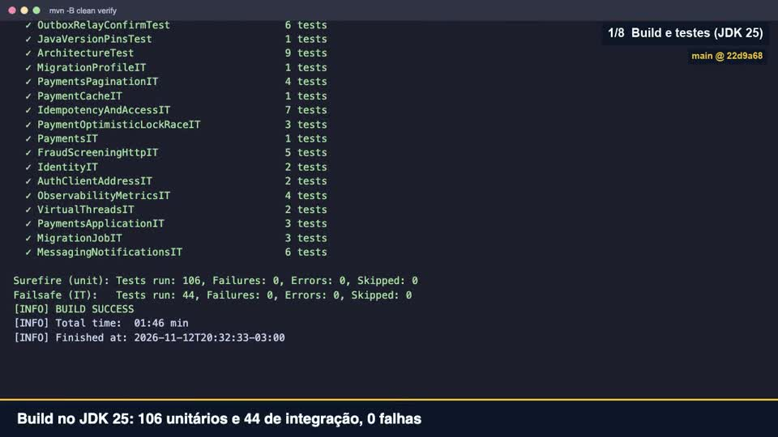

# Payments Platform 💳

A production-grade **Payments Modular Monolith** built with **Java 25**, **Spring Boot 3.5.16**, **Spring Modulith**, **PostgreSQL 16**, **Redis 7**, and **RabbitMQ 3.13**.

Architecture follows **Domain-Driven Design (DDD)**, **Clean Architecture**, **CQRS + Event Sourcing**, and the **Transactional Outbox Pattern**. Payment, User, RefreshTokenFamily and Notification use PostgreSQL event streams as their source of truth, with hybrid projections and offline replay.

## Demo
AI-assisted development: see [the universal skills and reviewer workflow](docs/ai-tooling.md), including `create-crud <resource>`, tests, local gate, Postman and Flyway. Canonical sources live in `.agents/`; harness entries point to them.


[](docs/demo/e2e-demo.mp4)

[Watch the end-to-end demo (2:30, MP4)](docs/demo/e2e-demo.mp4). It was recorded on `main` at `22d9a68` running Java 25. It shows `mvn verify` (106 unit and 44 integration tests), the Compose stack, the API smoke and newman runs, pagination, the fraud-screening review flow, concurrent confirms returning 409, the outbox to RabbitMQ flow with an empty DLQ, a k6 run, and traces, metrics and dashboards in Jaeger, Prometheus and Grafana. Tokens and passwords in the recording are masked.

## Architecture

Architecture, API, persistence, resilience, concurrency, observability, and testing guides: [docs/README.md](docs/README.md).
System diagrams and module boundaries: [docs/architecture.md](docs/architecture.md). Trade-offs: [docs/adr](docs/adr/README.md).

- **Modular Monolith**: base package `com.muse.payments` with verifiable architectural boundaries.
  - `identity`: User registration, authentication, token rotation, and role claims on the access token. Most payment routes require `USER` or `ADMIN`; payment review/list routes also use `FRAUD_REVIEWER`. See the [API role matrix](docs/api.md).
  - `payments`: Payment aggregate root, state machine (`PENDING` → `COMPLETED` / `CANCELLED`, and `UNDER_REVIEW` → `PENDING` or `CANCELLED`), fraud screening, idempotency key deduplication, and optimistic locking.
  - `notifications`: Event-driven notification dispatch via RabbitMQ with idempotent consumer (`processed_events`).
  - `shared`: Common domain building blocks, the outbox port, the processed-event store, security filters, and RFC 7807 problem details.
- **Persistence**: PostgreSQL 16 managed with Flyway. Event Sourcing consolidates the former V1–V7 history into V1–V4 for a clean database; append-only versioning resumes at V5.
- **Cache**: Redis 7 cache-aside for payment lookups with safe fallbacks.
- **Messaging**: RabbitMQ topic exchange `payments.events`. Created, completed, and cancelled events share `payments.created.notifications`, with listener retry, a dead-letter queue, and publisher confirms on the outbox relay. See [docs/architecture.md](docs/architecture.md).
- **Security**: Stateless Spring Security Resource Server with RS256 JWT tokens.

## Authorization

Roles travel in the JWT `roles` claim and are enforced as `ROLE_USER`, `ROLE_ADMIN`, and `ROLE_FRAUD_REVIEWER`. A missing or invalid token is **401**. A known token whose role is not allowed is **403** `application/problem+json`. Ownership misses on payments stay **404** so callers cannot tell whether another user's payment exists.

| Endpoint | Who can call it | Ownership |
|---|---|---|
| `POST /api/v1/auth/**` | Public | — |
| `POST /api/v1/payments` | `USER` or `ADMIN` | The caller owns the payment that is created |
| `GET /api/v1/payments/{id}` | `USER`, `ADMIN`, or `FRAUD_REVIEWER` | Owner, or any payment when the caller is `ADMIN` or `FRAUD_REVIEWER`. Another user's payment is **404** for `USER` |
| `GET /api/v1/payments/{id}/history` | `USER`, `ADMIN`, or `FRAUD_REVIEWER` | Same visibility as get-by-id; paged asynchronous timeline, briefly incomplete immediately after writes |
| `GET /api/v1/payments` | `USER` or `ADMIN` | Always the caller's own payments, including for `ADMIN`. `page`/`size`/`sort` outside the documented bounds are **400** (they used to be clamped) |
| `GET /api/v1/payments/under-review` | `ADMIN` or `FRAUD_REVIEWER` | Payments in `UNDER_REVIEW`, any owner. Same `page`/`size`/`sort` rules as the owner list |
| `POST /api/v1/payments/{id}/confirm` | `USER` or `ADMIN` | Owner only. `PENDING` only. `UNDER_REVIEW` is **409**. Another user's payment is **404** |
| `POST /api/v1/payments/{id}/review` | `ADMIN` or `FRAUD_REVIEWER` | Requires `decision=APPROVE` or `decision=REJECT`. Not the owner. `UNDER_REVIEW` only. `APPROVE` makes it `PENDING` and clears the screening reason. `REJECT` cancels it with the reviewer's reason. The owner, including an `ADMIN` who created the payment, is **403**. |
| `POST /api/v1/payments/{id}/cancel` | `USER` or `ADMIN` | Owner only. Another user's payment is **404** |
| `GET /api/v1/notifications` | Any authenticated user | The caller's own notifications |
| Actuator health, info, prometheus, and OpenAPI | Public | — |

`Idempotency-Key` on `POST /api/v1/payments` is kept for 24 hours after the attempt completes. A `PROCESSING` lease lives only for `app.idempotency.processing-ttl` (default 2 minutes). A crash during screening leaves an expired lease, and the next request with the same key reclaims it. After the completed row's `expires_at`, the same key is a new request. The lease commits before fraud screening, so a slow provider does not hold a database connection. A failed create releases that attempt so the key can be retried. An explicit fraud decline stores a generic 422 and replays it. The provider reason is not in the response. A provider that does not answer stores the payment as `UNDER_REVIEW` (not approved). Replaying that key still returns the original 201 `UNDER_REVIEW` body after a reviewer later approves the payment. Confirm is rejected until `POST /api/v1/payments/{id}/review?decision=APPROVE` by an `ADMIN` or `FRAUD_REVIEWER` who does not own the payment. Local runs need the Compose WireMock (`fraud-screening` on port 8090), which answers `CLEAR`. Set `FRAUD_SCREENING_BASE_URL`. Production requires that variable and `https`, and the base Kubernetes ConfigMap does not supply a stand-in URL. Completing a key extends `expires_at` to 24 hours and updates only the unexpired `PROCESSING` row for the lease acquired by that attempt. Each cleanup run deletes expired rows in batches of 500 (`FOR UPDATE SKIP LOCKED`) until none remain; the run interval is `app.idempotency.cleanup-interval-ms` (default 1 hour). The lookup index is `idx_idempotency_expires` from `V1__shared.sql`.

## Quickstart

### Prerequisites
- JDK 25
- Maven 3.9+
- Docker Engine (for Testcontainers and local compose)

### Running tests

Unit tests:

```bash
mvn -q test
```

Integration tests only:

```bash
mvn -q test-compile failsafe:integration-test failsafe:verify
```

Full build with unit and integration tests:

```bash
mvn clean verify
```

The project has no Maven Wrapper; use an installed Maven. For the Colima socket/Ryuk setup on macOS, see [Testing guide — macOS + Colima](docs/testing.md#macos--colima). That section documents `TESTCONTAINERS_RYUK_DISABLED` and `TESTCONTAINERS_DOCKER_SOCKET_OVERRIDE`.

### Newman and k6

With the local API running and ready, execute the ordered HTTP collection:

```bash
newman run src/test/postman/payments-v1.postman_collection.json \
  --env-var baseUrl=http://127.0.0.1:8080
```

Seed the payment-list dataset and run the k6 scenarios:

```bash
./perf/seed-payments.sh
./perf/run-k6.sh
```

The [testing guide](docs/testing.md) explains the suite split, Colima variables, Newman behavior, and how to read k6 p95. The [performance guide](perf/README.md) has dataset and scenario details.

### Running locally
Local integration tests run automatically against ephemeral containers via Testcontainers (`mvn clean verify`). The repository uses the Compose V2 plugin (`docker compose`); the V1 binary is `docker-compose` (hyphen). Both read `docker-compose.yml`.

To run the full local stack, copy the example environment file and start Compose from the repository root:

```bash
cp .env.example .env
docker compose up -d --build
curl -fsS http://127.0.0.1:8080/actuator/health/readiness
```

To run with **remote debugging** enabled (JDWP agent on port `5005`, attachable from IntelliJ/VS Code/Eclipse):

```bash
docker compose -f docker-compose.yml -f docker-compose.debug.yml up -d --build
# or using Makefile:
make debug
```

To run the application JVM on the host instead, start only its dependencies and source the local environment file:

```bash
docker compose up -d postgres redis rabbitmq fraud-screening
set -a
source .env
set +a
SPRING_PROFILES_ACTIVE=local mvn spring-boot:run
```

`mvn spring-boot:run` stays in the foreground. From a second shell, after the process is booting:

```bash
./scripts/validate-api.sh
```

The script polls readiness, then walks register, login, payment create/confirm, and notifications. API documentation is at `http://localhost:8080/swagger-ui.html`. The [Postman workflow](docs/postman.md) covers all business endpoints with ordered folders, preserved collection variables, token reuse, payload tests, pagination, cancellation, and optional fraud review. The load test and the list index explain are in [perf/README.md](perf/README.md).

### Services & Connection Endpoints

When running locally via Docker Compose, services are accessible on the host via loopback (`127.0.0.1` / `localhost`):

#### Core Infrastructure (`docker-compose.yml`)

| Service | Protocol / Port | Default Credentials | Documentation & Guide |
|---|---|---|---|
| **Spring Boot API** | HTTP `8080` | RS256 Bearer JWT | [docs/api.md](docs/api.md), [Swagger UI](http://localhost:8080/swagger-ui.html), [Readiness](http://localhost:8080/actuator/health/readiness) |
| **PostgreSQL 16** | TCP `5432` | User: `postgres`, Pass: `postgres`, DB: `payments` (`jdbc:postgresql://localhost:5432/payments`) | [docs/data.md](docs/data.md) |
| **Redis 7** | TCP `6379` | Password: `redis_secret` | [docs/concurrency.md](docs/concurrency.md) |
| **RabbitMQ 3.13** | AMQP `5672`, HTTP `15672` (Management UI) | User: `guest`, Password: `guest`, VHost: `/` | [docs/messaging.md](docs/messaging.md), [Management UI](http://localhost:15672) |
| **WireMock** | HTTP `8090` | Public mock provider | [docs/resilience.md](docs/resilience.md), [Mappings Admin](http://localhost:8090/__admin/mappings) |
| **JDWP Debugger** | TCP `5005` | Socket attach (started via `make debug`) | [docker-compose.debug.yml](docker-compose.debug.yml) |

#### Observability & Tracing (`docker-compose.observability.yml`)

Start the telemetry stack alongside core services:
```bash
docker compose -f docker-compose.yml -f docker-compose.observability.yml up -d
```

| Tool | UI / Port | Default Credentials | Documentation & Guide |
|---|---|---|---|
| **Grafana** | HTTP `3000` | User: `payments`, Password: `local-observability-only` | [docs/observability.md](docs/observability.md), [Payments Platform Dashboard](http://localhost:3000/d/payments-platform/payments-platform) |
| **Prometheus** | HTTP `9090` | Public metrics dashboard | [docs/observability.md](docs/observability.md), [Prometheus Graph UI](http://localhost:9090/graph) |
| **Jaeger UI** | HTTP `16686` | Distributed traces UI | [docs/observability.md](docs/observability.md), [Jaeger Search](http://localhost:16686/search?service=payments-platform) |
| **OTEL Collector** | HTTP `4318` (OTLP HTTP), `4317` (gRPC) | Ingestion pipeline | [docs/observability.md](docs/observability.md) |
| **Kibana** *(logs profile)* | HTTP `5601` | Search UI (local search cluster) | [docs/observability.md](docs/observability.md), [Kibana UI](http://localhost:5601) |
| **Elasticsearch** *(logs profile)* | HTTP `9200` | Search storage engine | [docs/observability.md](docs/observability.md) |

> **Note on Local Logs vs. Kibana:** In local development, the application writes colored human-readable logs directly to standard output (`stdout`), visible in the IntelliJ console or terminal. The optional `--profile logs` starts Elasticsearch and Kibana search infrastructure, but there is no local log shipper (such as Filebeat or Vector) running on the host Mac to capture IntelliJ's terminal stdout into Elasticsearch. In production (Kubernetes), containers emit structured ECS JSON to stdout, which a cluster DaemonSet automatically ships to Elasticsearch for Kibana querying.

For comprehensive architecture decisions, performance tuning, and operational runbooks, browse the complete documentation index at [docs/README.md](docs/README.md) or the machine-readable inventory at [docs/llms.txt](docs/llms.txt).

### Resetting the local database

`scripts/db-reset.sh` drops the local schema, replays all Flyway migrations from zero through the migration-only mode below, and clears local Redis and the notification queues. It is destructive, refuses non-local hosts, and needs `--yes` (or a typed `RESET`). Stop the app first. Run it once after pulling a change that rewrites migrations. Details: [docs/data.md](docs/data.md#resetting-the-local-database).

### Kubernetes migration Job

The Job in `deploy/k8s/base/flyway-job.yaml` is named `payments-flyway-migration` and sets `APP_MIGRATION_ONLY=true`. The process applies Flyway, does not serve HTTP, and does not start Rabbit consumers or the outbox scheduler. It exits `0` only after migrations are applied and nothing is pending, and exits non-zero if startup or Flyway fails. Replicas inherit `SPRING_FLYWAY_ENABLED=false` from the ConfigMap and leave `APP_MIGRATION_ONLY` unset, so they do not migrate and they keep serving traffic.

Local migration against Compose dependencies, without starting the HTTP server:

```bash
APP_MIGRATION_ONLY=true mvn spring-boot:run
```

## Deploy

Runbooks for Railway (preferred), Render, and Cloud Run, plus rollback and troubleshooting: [docs/deploy.md](docs/deploy.md).
Kubernetes layout and apply order: [deploy/k8s/README.md](deploy/k8s/README.md) and `scripts/k8s-apply.sh`.
HTTP smoke test: `scripts/validate-api.sh`.
Do not run this JVM on Vercel Functions. That decision is [ADR 0011](docs/adr/0011-railway-vs-other-hosting.md). No production project is created from this repository.
