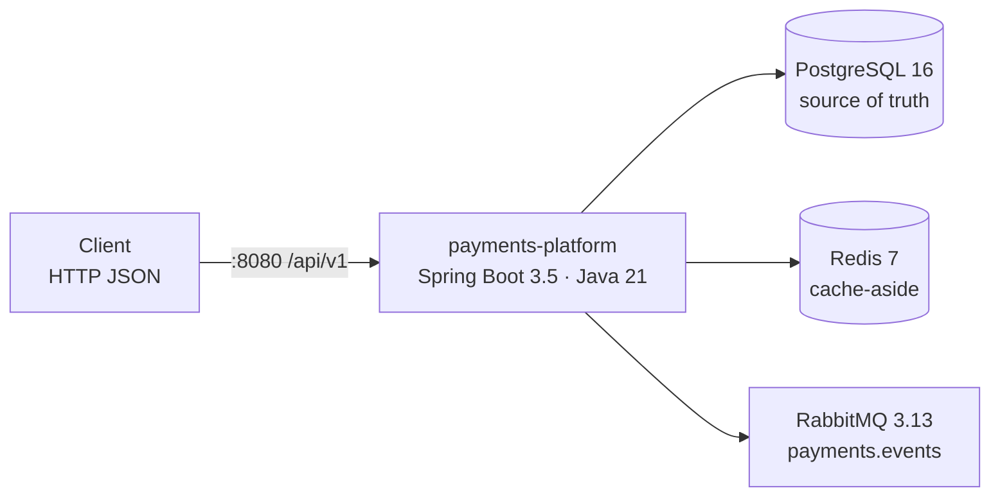
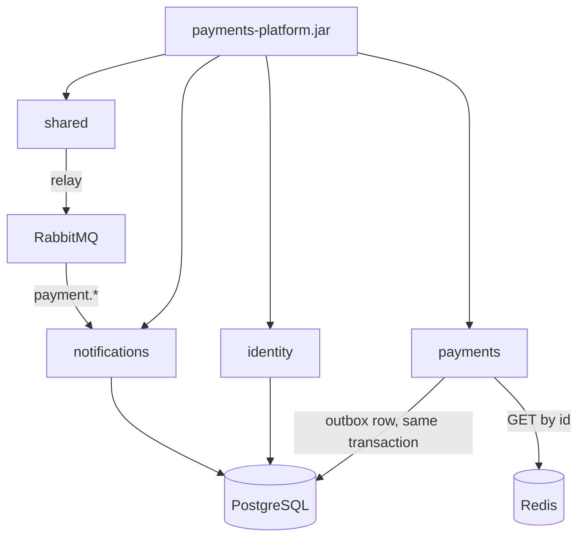
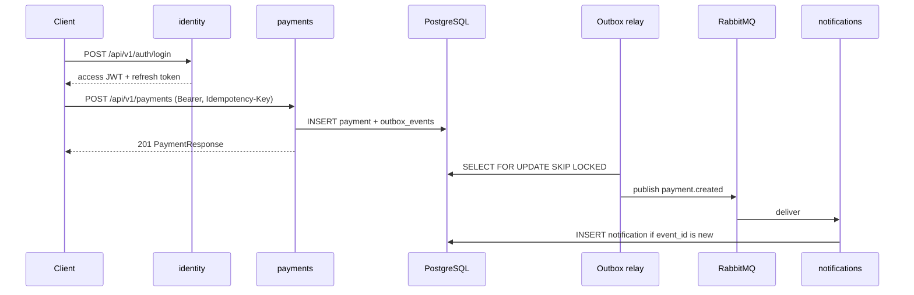
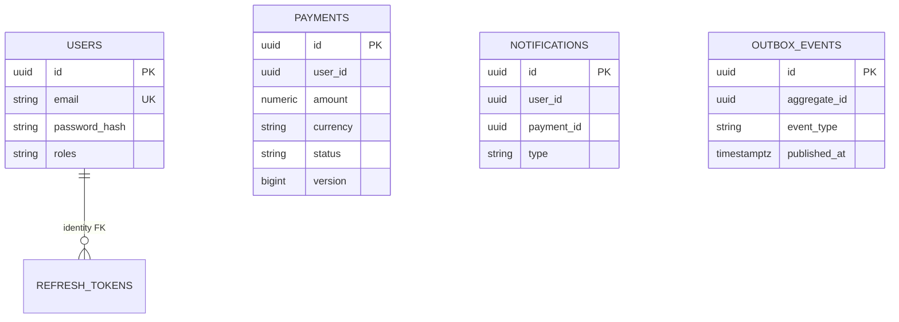

# Architecture — Payments Platform

One Spring Boot process (`com.muse.payments.PaymentsApplication`) on Java 21.
Modules: `identity`, `payments`, `notifications`, and an open `shared` kernel.
The trip-planner slices in ADR 0001 are retired. See [ADR 0002](adr/0002-payments-pivot.md) and [ADR 0003](adr/0003-modular-monolith-vs-microservices.md).

## System context (C4 L1)

## Containers (C4 L2)

Still one deployable. Redis, PostgreSQL, and RabbitMQ are separate processes.

## Module map

| Module | Package | Owns | Talks to others |
|---|---|---|---|
| identity | `com.muse.payments.identity` | `users`, `refresh_tokens` | Issues JWT used by the other HTTP APIs. No foreign keys into payments. |
| payments | `com.muse.payments.payments` | `payments` | Appends integration events to `outbox_events`. Does not call the notifications repository. |
| notifications | `com.muse.payments.notifications` | `notifications` | Learns about payments only from RabbitMQ. |
| shared | `com.muse.payments.shared` | `outbox_events`, `processed_events`, `idempotency_keys` | Open kernel: CQRS ports, outbox, security, problem details. |

Inside each business module the packages are `domain`, `application`, `infrastructure`, and `web`.
`domain` is plain Java (ArchUnit). Application handlers are the CQRS boundary.
Infrastructure holds JPA, Redis, and RabbitMQ adapters.

There is no cross-module foreign key. `payments.user_id` and `notifications.user_id` are UUID columns plus indexes. `refresh_tokens.user_id` references `users` because both tables belong to identity.

## Request paths

`GET /api/v1/payments/{id}` is cache-aside in Redis. PostgreSQL is read on a miss.
Confirm and cancel evict the key after the database transaction commits.

## HTTP contract

Base path `/api/v1`. Errors are RFC 7807 `application/problem+json` with `correlationId` and no stack trace.

| Method | Path | Auth | Success |
|---|---|---|---|
| POST | `/api/v1/auth/register` | public | 201 |
| POST | `/api/v1/auth/login` | public | 200 |
| POST | `/api/v1/auth/refresh` | public | 200, rotated pair |
| POST | `/api/v1/auth/logout` | public | 204 |
| POST | `/api/v1/payments` | Bearer | 201, requires `Idempotency-Key` |
| GET | `/api/v1/payments/{id}` | Bearer, owner | 200 |
| GET | `/api/v1/payments` | Bearer | 200, page of the caller's payments |
| POST | `/api/v1/payments/{id}/confirm` | Bearer, owner | 200 |
| POST | `/api/v1/payments/{id}/cancel` | Bearer, owner | 200 |
| GET | `/api/v1/notifications` | Bearer | 200, caller's notifications |

Status codes in use: 400 validation, 401 missing or invalid token, 403 role failure, 404 unknown id or another user's payment (no enumeration), 409 illegal transition, idempotency mismatch, or optimistic lock, 429 auth rate limit with `Retry-After`, 500 generic problem detail.

OpenAPI: `/v3/api-docs`. Swagger UI: `/swagger-ui.html`.

## Consistency and delivery

Writes commit the aggregate and the outbox row in one transaction.
The relay publishes later. The consumer inserts a notification and a `processed_events` row in one transaction, so a duplicate delivery does not create a second notification.
That is at-least-once delivery plus an idempotent consumer. It is not exactly-once.

The relay retries publish with exponential backoff and jitter when the send throws. The queue `payments.created.notifications` is bound to `payment.created` and dead-letters to `payments.created.notifications.dlq`. The connection is configured with `publisher-confirm-type: correlated`.

## Boundaries

`ApplicationModules.of(PaymentsApplication.class).verify()` and `ArchitectureTest` run in the build.
Domain types do not depend on Spring, JPA, Redis, or RabbitMQ.
Constructor injection only.

## Data model

Flyway migrations are append-only: `V1` shared outbox and idempotency, `V2` identity, `V3` payments, `V4` notifications.
