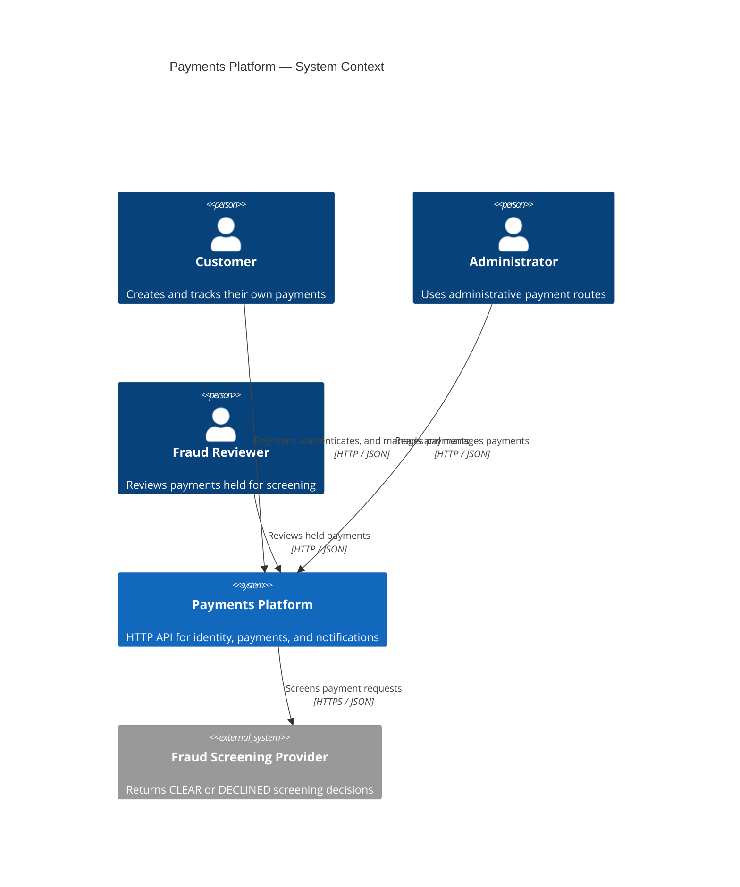
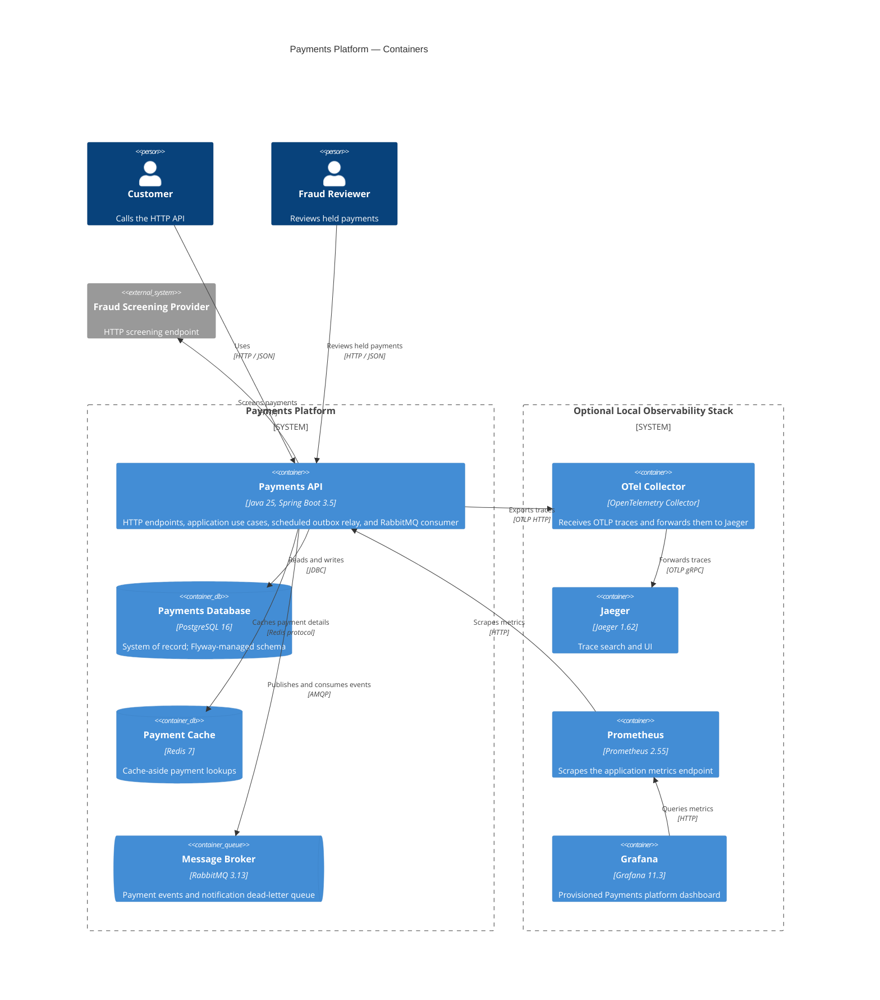
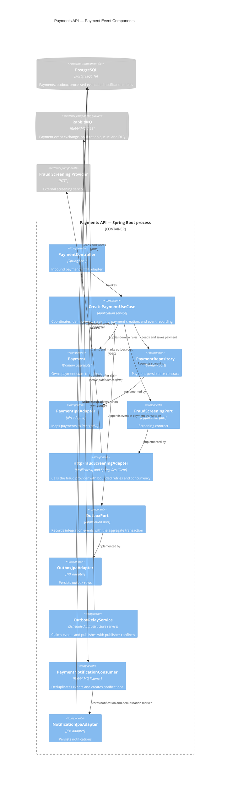
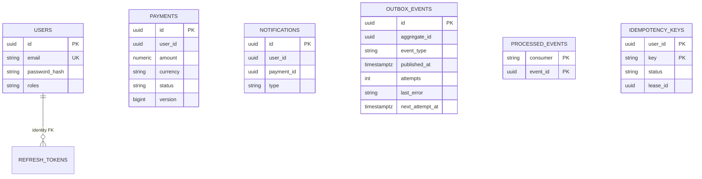

# Architecture — Payments Platform

One Spring Boot process (`com.muse.payments.PaymentsApplication`) on Java 25.
Modules: `identity`, `payments`, `notifications`, and an open `shared` kernel. Open means a Spring Modulith module of type `OPEN`: the other modules may depend on it. It holds ports and cross-cutting types, not payment rules.
The trip-planner slices in ADR 0001 are retired. See [ADR 0002](adr/0002-payments-pivot.md) and [ADR 0003](adr/0003-modular-monolith-vs-microservices.md).

## System context (C4 level 1)



## Containers (C4 level 2)

The application is one Spring Boot deployable. PostgreSQL, Redis, and RabbitMQ run as separate services. The observability services shown are the optional local Compose overlay.



## Components (C4 level 3)



## Layers, dependency rule, and CQRS

The code uses `domain`, `application`, `web`, and `infrastructure` packages. There is no package literally named `adapters`: inbound web controllers and outbound persistence, cache, fraud, and messaging adapters live in `web` and `infrastructure`.

| Logical layer | Code locations | Responsibility |
|---|---|---|
| Domain | `*/domain` | Plain Java entities, value types, state rules, and repository contracts. Domain code does not depend on Spring, JPA, Redis, RabbitMQ, or Jackson. |
| Application | `*/application`, `shared/application` | Commands, queries, handlers, use cases, and ports such as `FraudScreeningPort`, `PaymentCachePort`, and `OutboxPort`. |
| Adapters | `*/web`, selected `*/infrastructure` classes | HTTP controllers adapt inbound requests; JPA, Redis, and RabbitMQ implementations adapt outbound ports. |
| Infrastructure | `*/infrastructure`, application configuration | Spring wiring, persistence mappings, transport clients, schedulers, and framework integration. |

Dependencies point inward: web and infrastructure code may call application contracts and domain rules; domain code stays independent of framework and transport packages. `ArchitectureTest` checks domain purity, and `ModularityTest` checks Spring Modulith module boundaries. The `shared` module is deliberately open for cross-cutting ports and types; it does not own payment business rules.

Commands change state and may append integration events in the same transaction. Queries return read-only results and do not mutate aggregates. Payment and identity use application handlers; identity currently has no query types. Notifications currently has no application package: its controller calls `NotificationRepository`, while its consumer persists delivered events. CQRS here does not mean event sourcing; see [ADR 0004](adr/0004-cqrs-without-event-sourcing.md).

## Module map

| Module | Package | Owns | Talks to others |
|---|---|---|---|
| identity | `com.muse.payments.identity` | `users`, `refresh_tokens` | Issues JWT used by the other HTTP APIs. No foreign keys into payments. |
| payments | `com.muse.payments.payments` | `payments` | Appends integration events to `outbox_events`. Does not call the notifications repository. |
| notifications | `com.muse.payments.notifications` | `notifications` | Learns about payments only from RabbitMQ. |
| shared | `com.muse.payments.shared` | `outbox_events`, `processed_events`, `idempotency_keys` | Depended on by identity, payments, and notifications. Not a business module. |

`identity` and `payments` use `domain`, `application`, `infrastructure`, and `web`.
`notifications` has `domain`, `application`, `infrastructure`, and `web`.
`ListNotificationsQueryHandler` owns the read use case and maps domain notifications to an application response record; `NotificationController` depends only on that handler.
`domain` is plain Java: `ArchitectureTest` allows only the JDK and other `domain` packages.
Payment and identity commands, and the payment queries, go through application handlers. Identity has no query types.
Infrastructure holds JPA, Redis, and RabbitMQ adapters.

There is no cross-module foreign key. `payments.user_id` and `notifications.user_id` are UUID columns plus indexes. `refresh_tokens.user_id` references `users` because both tables belong to identity.

## Payment, outbox, broker, and dead-letter flow

```mermaid
sequenceDiagram
    autonumber
    actor C as Customer
    participant API as PaymentController
    participant UC as CreatePaymentUseCase
    participant F as Fraud screening adapter
    participant DB as PostgreSQL
    participant R as Outbox relay
    participant MQ as RabbitMQ exchange and queue
    participant N as Payment notification consumer
    participant DLX as Dead-letter exchange
    participant DLQ as Dead-letter queue
    C->>API: POST /api/v1/payments + Bearer + Idempotency-Key
    API->>UC: Create payment
    UC->>DB: Commit short-lived idempotency lease
    UC->>F: Screen outside payment transaction
    F-->>UC: CLEAR, DECLINED, or fallback UNDER_REVIEW
    UC->>DB: Commit payment + outbox event + stored response
    API-->>C: 201 Created (or 422 for explicit decline)
    loop Poll eligible rows
        R->>DB: Claim with SELECT FOR UPDATE SKIP LOCKED
        R->>MQ: Publish event and await publisher confirm
        alt Publisher confirm succeeds
            MQ-->>R: Confirm
            R->>DB: Set published_at
        else Publish or confirm fails
            R->>DB: Schedule outbox retry; row remains unpublished
        end
    end
    MQ->>N: Deliver payment event
    alt Consumer transaction succeeds
        N->>DB: Insert notification and processed_events marker
        N-->>MQ: Acknowledge
    else Permanent error or listener retries exhausted
        N-->>MQ: Reject without requeue
        MQ->>DLX: Dead-letter rejected message
        DLX->>DLQ: Route with payment.created.dlq
    end
```

The DLQ handles messages rejected by the notification consumer. A publisher failure stays in the PostgreSQL outbox and is retried by the relay; it does not go directly to the RabbitMQ DLQ. Confirm and cancel commands also append outbox events. See [messaging.md](messaging.md) for retry, routing, and consumer details.

`GET /api/v1/payments/{id}` uses Redis cache-aside. Confirm and cancel evict the key after the database transaction commits. See [concurrency.md](concurrency.md) for cache stampede protection and transaction behavior.

## HTTP contract

Base path `/api/v1`. Errors are RFC 7807 `application/problem+json` and omit the stack trace. `CorrelationIdFilter` accepts `X-Correlation-Id` when it is 1–64 characters from `[A-Za-z0-9_-]`, otherwise generates a UUID, echoes that value on the response header, and copies it onto the problem body as `correlationId`.

| Method | Path | Auth | Success |
|---|---|---|---|
| POST | `/api/v1/auth/register` | public | 201 |
| POST | `/api/v1/auth/login` | public | 200 |
| POST | `/api/v1/auth/refresh` | public | 200, rotated pair |
| POST | `/api/v1/auth/logout` | public | 204 |
| POST | `/api/v1/payments` | Bearer, `USER` or `ADMIN` | 201, requires `Idempotency-Key`. The caller owns the payment |
| GET | `/api/v1/payments/{id}` | Bearer, `USER`, `ADMIN`, or `FRAUD_REVIEWER` | 200 for the owner, or for any payment when the caller is `ADMIN` or `FRAUD_REVIEWER` |
| GET | `/api/v1/payments` | Bearer, `USER` or `ADMIN` | 200, the caller's own payments, including when the caller is `ADMIN` |
| GET | `/api/v1/payments/under-review` | Bearer, `ADMIN` or `FRAUD_REVIEWER` | 200, payments in `UNDER_REVIEW`. Same `page`, `size`, and `sort` rules as the owner list |
| POST | `/api/v1/payments/{id}/confirm` | Bearer, `USER` or `ADMIN`, owner | 200. Another user's payment is 404, including for `ADMIN`. `UNDER_REVIEW` is 409 |
| POST | `/api/v1/payments/{id}/review` | Bearer, `ADMIN` or `FRAUD_REVIEWER`, not the owner | 200. Query `decision=APPROVE` or `REJECT`. The owner is 403, including an `ADMIN` who created the payment |
| POST | `/api/v1/payments/{id}/cancel` | Bearer, `USER` or `ADMIN`, owner | 200. Another user's payment is 404, including for `ADMIN` |
| GET | `/api/v1/notifications` | Bearer | 200, caller's notifications |

Status codes the handlers return:

| Status | When |
|---|---|
| 400 | Bean validation, malformed JSON, missing `Idempotency-Key`, a key longer than 120 characters, an invalid payment list `page`, `size`, or `sort`, or a typed parameter that does not convert (including a payment `id` that is not a UUID). `application/problem+json` |
| 401 | Missing or invalid bearer token, bad login or refresh credentials, or a disabled account (`BadCredentialsException` / `AuthenticationException`). `application/problem+json` |
| 403 | Authenticated token that lacks the required role for a payment route: `USER`/`ADMIN` for most payment routes, `ADMIN`/`FRAUD_REVIEWER` for the held list and review route. Also returned when the reviewer owns the payment. `application/problem+json` |
| 404 | Unknown payment id, or a payment the caller does not own. `ADMIN` may get any payment by id. List, confirm, and cancel stay owner-only, so a non-owner `ADMIN` is still 404 on confirm and cancel |
| 409 | Illegal payment transition, duplicate registration email, idempotency payload mismatch, idempotency key still in `PROCESSING` and unexpired, or `DataIntegrityViolationException`. These use `type` `urn:problem-type:409`. An optimistic lock uses the same status and the title `Concurrent Modification`, with `type` `urn:problem-type:concurrent-modification` |
| 422 | Explicit fraud decline. The body is `Payment was declined by fraud screening.` The provider reason is not included. The same key replays this response |
| 429 | Register, login, and refresh over 20 requests per minute for `request.getRemoteAddr()`. `Retry-After` is `60`. Logout has no limit. The app does not read `X-Forwarded-For` itself |
| 503 | Transient database lock: deadlock (`40P01` → `PessimisticLockingFailureException`) or serialization failure (`40001` → `CannotAcquireLockException`). `type` is `urn:problem-type:transient-lock` and `Retry-After` is `1`. Retry the same request |
| 500 | Unhandled exception, generic problem detail, no stack trace |

Roles travel in the JWT `roles` claim and are enforced as `ROLE_USER`, `ROLE_ADMIN`, and `ROLE_FRAUD_REVIEWER`. The payment filter chain requires `USER` or `ADMIN`, except `POST /api/v1/payments/{id}/review`, which requires `ADMIN` or `FRAUD_REVIEWER`. A missing or invalid token is 401. A known token without them is 403 `application/problem+json`. An ownership miss stays 404 so callers cannot tell whether another user's payment exists. `GET /api/v1/notifications` stays any authenticated user and owner-scoped.

`server.forward-headers-strategy` is `native`, so Tomcat's `RemoteIpValve` copies `X-Forwarded-For` into the remote address only when the immediate peer matches `server.tomcat.remoteip.internal-proxies` (private ranges, including localhost and typical ingress networks). A client that connects directly cannot pick its rate-limit key by sending the header. If the edge proxy's source address is public, add it to that property.

Optimistic locking covers the read-modify-write inside the confirm or cancel transaction. There is no `ETag` or `If-Match`. A second request that starts after the winner commits is rejected by the state machine (`urn:problem-type:409`), not by the version check.

A repeated create with the same user, unexpired `Idempotency-Key`, and canonical body (amount scaled to 2 decimals, currency uppercased) returns the stored response and sets `Idempotent-Replayed: true`. A completed row's `expires_at` is 24 hours ahead. A `PROCESSING` lease expires after `app.idempotency.processing-ttl` (default 2 minutes) and can be reclaimed. Lookup of a completed response requires `expires_at > now`. After that, the same key is a new payment. Create commits the idempotency lease in its own transaction, calls the fraud provider with no database connection held, then commits the payment, the outbox row, and the cached response together. An explicit decline commits a 422 problem body on that lease instead of a payment. Any other failure deletes the `PROCESSING` lease. Completion extends `expires_at` to 24 hours and updates only the unexpired `PROCESSING` row for that attempt's `lease_id`. Replaying the key of a payment created as `UNDER_REVIEW` returns that original 201 body even after a reviewer approves the payment. Each cleanup run deletes expired rows in batches of 500 (`FOR UPDATE SKIP LOCKED`) until a short batch remains (`app.idempotency.cleanup-interval-ms`, default 1 hour). Cancel takes an optional `reason` query parameter; the default is `Customer requested cancellation`. List payments is an offset page: `page` (default 0, must be >= 0), `size` (default 20, must be from 1 to 100), and `sort`. `page * size` must be <= 10000. `sort` is case-sensitive: `createdAt,desc` (default; `created_at DESC, id DESC`) or `createdAt,asc` (`created_at ASC, id ASC`). Spring joins repeated `sort` parameters with a comma, so `sort=createdAt&sort=desc` matches the default and two full values do not. A negative page, a size outside 1..100, a non-integer page or size, an offset above 10000, and any other sort, including `createdAt,DESC`, are HTTP 400 and are not clamped. That is a breaking change for clients that sent `size=0` or `size` above 100 and previously received a clamped page. Omitting the three parameters stays compatible. The body keeps `items`, `page`, `size`, `totalElements`, and `totalPages`, and adds `sort`. Order is stable for a static dataset. A concurrent insert or delete can shift a later offset page, and `totalElements` can disagree with `items`, because the page and the count are two reads. The list index is `idx_payments_user_created_at_id` from `V6__payments_list_index.sql` (`PAYMENTS_LIST_INDEX_VERSION`). See [perf/README.md](../perf/README.md).

OpenAPI: `/v3/api-docs`. Swagger UI: `/swagger-ui.html`.

## Consistency and delivery

Create, confirm, and cancel commit the aggregate and the outbox row in one transaction.
`OutboxJpaAdapter.append` is `@Transactional(propagation = MANDATORY)`. `OutboxPort` itself is a plain interface.
The append stores `correlationId` and the current W3C `traceparent` on the outbox headers.
Confirm and cancel follow the same relay and the same notifications queue as create.

The relay (`OutboxRelayService`) is scheduled when `app.outbox.scheduling.enabled` is unset or `true` (`SchedulingConfig`). The schedule is a fixed delay of `app.outbox.poll-interval-ms` milliseconds (default 1000). Each tick handles up to 20 batches of up to 50 due rows. One claim transaction per batch runs `SELECT … LIMIT 50 … FOR UPDATE SKIP LOCKED` where `published_at IS NULL` and `next_attempt_at <= now`, keeps the first row of each aggregate, sets `next_attempt_at` of those rows to now plus `app.messaging.confirm-timeout` (default 5s) plus 10 seconds with one `UPDATE`, and commits. The row locks are released before the broker call. Another relay skips those rows until the lease expires. A later row of the same aggregate goes out in a following batch ([ADR 0015](adr/0015-virtual-thread-hot-paths.md)).

Each attempt publishes to the topic exchange `payments.events` with its own confirm correlation id. `spring.rabbitmq.publisher-confirm-type` is `correlated`, `publisher-returns` is true, and the `RabbitTemplate` is mandatory. The outbox id travels as `X-Event-Id`. The relay restores the stored `traceparent` before `convertAndSend`. The rows of a batch are sent without waiting between messages and their confirms are awaited together, each with the full confirm timeout from its own send. One short transaction sets `published_at` for every row the broker acked without a return. `attempts` stays unchanged on that success. A nack, a return, a confirm timeout, or a send exception increments `attempts`, stores `last_error` (truncated at 500 characters), and sets `next_attempt_at` to now plus `min(300, 2^min(attempts, 8) * 2 + jitter)` seconds. Jitter is an integer from 1 through 3 (`PublishRetryBackoff`). The row stays unpublished until a later attempt succeeds. A crash after the broker accepts the message and before `published_at` commits publishes a duplicate once the lease expires. An interrupt stops the rest of that tick and leaves the interrupt flag set; rows of the current batch without a confirm keep their lease until it expires.

| Outbox `event_type` | Routing key | Queue |
|---|---|---|
| `PaymentCreated` | `payment.created` | `payments.created.notifications` |
| `PaymentHeldForReview` | `payment.held` | `payments.created.notifications` |
| `PaymentCompleted` | `payment.completed` | `payments.created.notifications` |
| `PaymentCancelled` | `payment.cancelled` | `payments.created.notifications` |

The queue name and the dead-letter routing key `payment.created.dlq` stayed from the created-only topology. Completed and cancelled are additional bindings on that queue, and every notification reject uses the same dead-letter key. The dead-letter exchange is the durable direct exchange `payments.events.dlx`, bound to the durable queue `payments.created.notifications.dlq`. The main queue sets no message TTL and no max length.

`PaymentNotificationConsumer` listens on `payments.created.notifications`. It inserts the notification and a `processed_events` row (`consumer = PaymentNotificationConsumer`, primary key `(consumer, event_id)`) in one transaction. The event id is `X-Event-Id`, or a body `eventId` when the header is absent. `paymentId` is not an event id. A second delivery of the same event id is acknowledged and does not insert a second notification. `PaymentCreated`, `PaymentHeldForReview`, `PaymentCompleted`, and `PaymentCancelled` each create a notification (`PAYMENT_CREATED`, `PAYMENT_HELD_FOR_REVIEW`, `PAYMENT_COMPLETED`, `PAYMENT_CANCELLED`). `PaymentHeldForReview` says the payment is under review and was not approved. `PaymentCreated` is emitted only for a payment that screening cleared, or later when a review releases a held payment to `PENDING`.

Payment status:

| Status | Meaning | Confirm | Cancel | Review |
|---|---|---|---|---|
| `PENDING` | Screening cleared the payment. It is not completed yet. | to `COMPLETED` | to `CANCELLED` | rejected |
| `UNDER_REVIEW` | The provider did not return a decision. This is not an approval. The screening reason is stored on the row and is not returned to the client. | 409 | to `CANCELLED` | `ADMIN` or `FRAUD_REVIEWER` who is not the owner. `APPROVE` moves it to `PENDING` and clears the reason; `REJECT` cancels it with the reviewer's reason |
| `COMPLETED` | Confirmed. | 409 | 409 | rejected |
| `CANCELLED` | Cancelled by the owner or rejected in review. | 409 | 409 | rejected |

`screening_reason`, `held_reason`, `reviewer_id`, and `reviewed_at` are added by `V7__payment_screening_reason.sql`, after the list index in `V6__payments_list_index.sql`. Approval clears `screening_reason` and keeps `held_reason`. The fraud provider is an HTTP `POST /v1/screenings` behind `FraudScreeningPort`. Resilience4j (retry, circuit breaker, bulkhead, time limiter) lives only in the infrastructure adapter. The instance name is `fraudScreening`. `FRAUD_SCREENING_BASE_URL` is required and must be `https` on the `prod` profile. The base Kubernetes ConfigMap does not set it. Local Compose runs a WireMock that answers `CLEAR`. Failure policy is [ADR 0012](adr/0012-fraud-screening-failure-policy.md).

Permanent failures throw `AmqpRejectAndDontRequeueException` and skip the retry budget: a missing or invalid event id, a missing event type, invalid JSON, a non-object payload, a missing or invalid identifier, or an unknown event type. The listener transaction rolls back, so `processed_events` does not keep that id. Transient failures (the listener wraps them in `RuntimeException`) are retried by the advice chain on the listener container factory: `app.messaging.listener-max-attempts` (default 5), `listener-initial-interval-ms` (default 500), `listener-multiplier` (default 2.0), and `listener-max-interval-ms` (default 10000, a hard cap), with exponential backoff and jitter. `spring.rabbitmq.listener.simple.retry` does not configure this chain. Other listener container properties, including `auto-startup`, still come from Boot. `defaultRequeueRejected` is false. After the attempt budget, `RejectAndDontRequeueRecoverer` rejects without requeue and RabbitMQ routes the message to the DLQ. DLQ messages stay there until an operator inspects them.

That is at-least-once delivery plus an idempotent consumer for all three payment events. Delivery detail is in [messaging.md](messaging.md).

## Observability

Health, Prometheus metrics, and OpenTelemetry traces describe the running process. PostgreSQL remains the source of truth. Alert rules and the local collector stack are in [observability.md](observability.md).

| Signal | Where |
|---|---|
| Liveness / readiness | `/actuator/health/liveness`, `/actuator/health/readiness` (readiness includes the database) |
| Metrics | `/actuator/prometheus`, common tag `application=payments-platform` |
| Traces | OTLP HTTP. Default samples every trace and exports to `http://localhost:4318/v1/traces`. Profile `prod` samples 10% unless `TRACING_SAMPLING_PROBABILITY` is set, and exports nothing until a collector URL is set. |
| Correlation | `X-Correlation-Id` on the HTTP response, the outbox headers, and the AMQP header. MDC key `correlationId`. |
| Trace context | W3C `traceparent` on the outbox row. The relay restores it before publish. Listener and template observations continue that trace id. |
| Logs | Plain text locally, with `traceId`, `spanId`, and `correlationId` in the level pattern. Profile `prod` sets `logging.structured.format.console=ecs`. |

`OTEL_EXPORTER_OTLP_ENDPOINT` is the collector base URL. `OtlpEndpointNormalizer` appends `/v1/traces` when that path is missing. Spring Boot 3.5 loads that post-processor from `META-INF/spring.factories`. `OTEL_EXPORTER_OTLP_TRACES_ENDPOINT` is the full traces URL and wins when both are set. A blank endpoint disables export. Tests set `management.tracing.enabled=false`.

| Meter | Type | Meaning |
|---|---|---|
| `payments.outbox.pending` | gauge | Rows with `published_at` null, including rows currently leased |
| `payments.outbox.lag.seconds` | gauge | Age of the oldest unpublished `occurred_at` |
| `payments.outbox.publish.lag` | timer | Time from `occurred_at` until `published_at` is set. SLO buckets at 1s, 10s, 30s, and 60s |
| `payments.outbox.attempts` | gauge | Sum of `attempts` on unpublished rows |
| `payments.queue.messages` | gauge | Ready messages. Tags `role=main` on `payments.created.notifications` and `role=dlq` on `payments.created.notifications.dlq`, plus the queue name |
| `payments.cache.hits` / `payments.cache.misses` / `payments.cache.errors` | counters | Cache-aside outcomes |
| `payments.cache.latency` | timer | Cache read latency |
| `http.server.requests` | timer | API latency. SLO buckets at 100ms, 300ms, 500ms, and 1s |

A scrape that cannot reach PostgreSQL or RabbitMQ, or that finds a queue missing, records `NaN` for that gauge and logs a warning. The HTTP request is unaffected.

## Process modes

The serving process handles HTTP, runs the outbox relay, and consumes notifications.
`APP_MIGRATION_ONLY=true` is read by `MigrationOnlyMode` (command line, then the system property `app.migration-only`, then the environment variable). `PaymentsApplication` then forces Flyway on, a non-web application type, listener auto-startup off, outbox scheduling off, and `spring.modulith.moments.enabled=false` (Moments would otherwise turn scheduling back on). Those overrides sit ahead of environment variables. The process serves no HTTP, starts no Rabbit consumers, and starts no outbox scheduler. It exits `0` only when Flyway has applied the schema, nothing is pending, and those runtime checks pass. Startup failure, a missing Flyway bean, pending migrations, or zero applied migrations exit non-zero. The Kubernetes Job sets the variable. Replicas leave it unset and inherit `SPRING_FLYWAY_ENABLED=false`.

## Boundaries

`ModularityTest` calls `ApplicationModules.of(PaymentsApplication.class).verify()`.
`ArchitectureTest` rejects `@Autowired` fields and any `domain` dependency outside the JDK and `domain` packages, which keeps Spring, JPA, Redis, and RabbitMQ out of the domain.
Production types take dependencies by constructor. The field-injection rule does not scan tests.

## Data model

Selected columns. The Flyway scripts are the full schema.



Flyway migrations are append-only from V1 through V7. See [data.md](data.md) for each migration, all indexes, the V6 concurrent index build, and a query/index discrepancy found in the current source.

## Eval

```bash
rtk mvn -q -Dtest=ArchitectureTest,ModularityTest test
```

Expected result: ArchUnit and Spring Modulith boundary checks pass.
