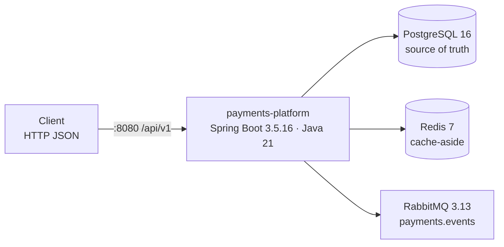
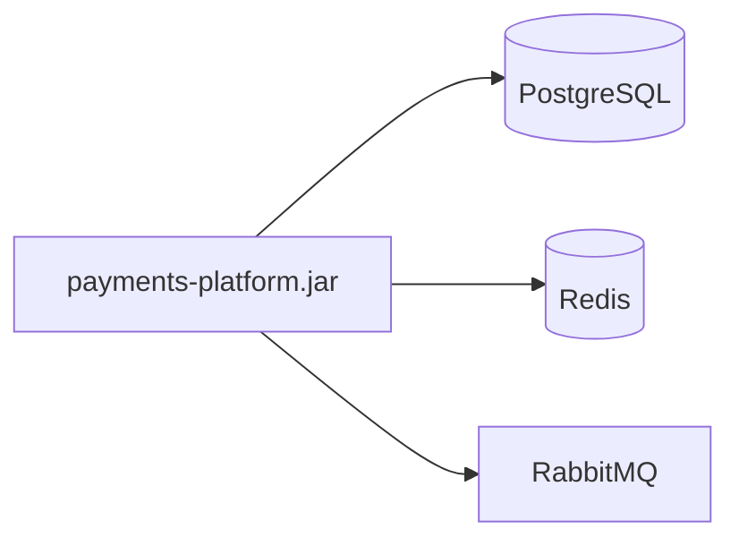
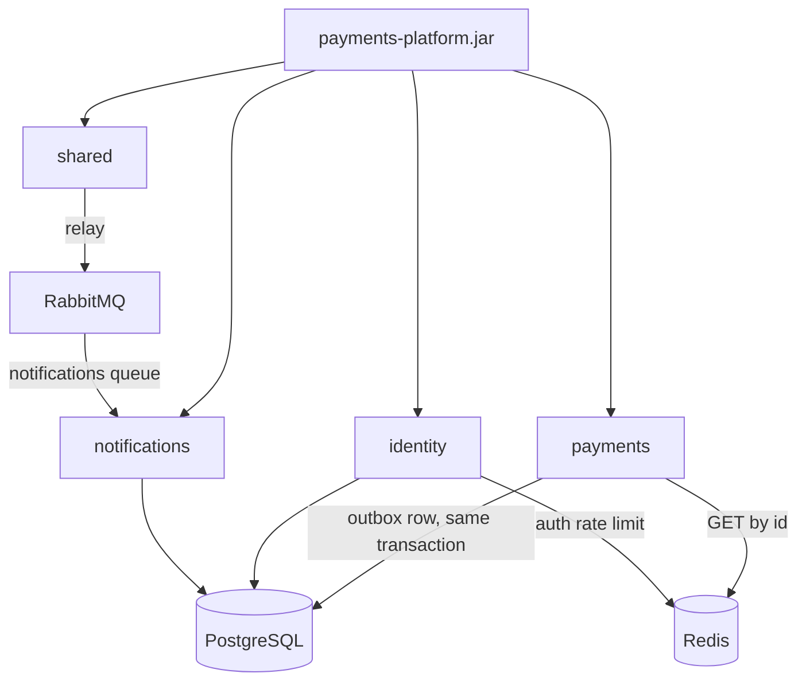
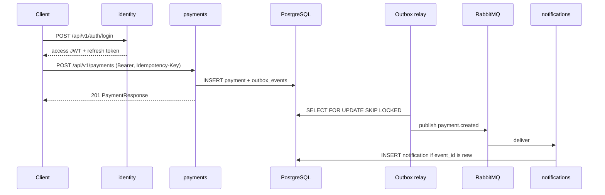

# Architecture — Payments Platform

One Spring Boot process (`com.muse.payments.PaymentsApplication`) on Java 21.
Modules: `identity`, `payments`, `notifications`, and an open `shared` kernel. Open means a Spring Modulith module of type `OPEN`: the other modules may depend on it. It holds ports and cross-cutting types, not payment rules.
The trip-planner slices in ADR 0001 are retired. See [ADR 0002](adr/0002-payments-pivot.md) and [ADR 0003](adr/0003-modular-monolith-vs-microservices.md).

## System context (C4 L1)

## Containers (C4 L2)

The application is one deployable. Redis, PostgreSQL, and RabbitMQ are separate processes.

## Components (C4 L3)

## Module map

| Module | Package | Owns | Talks to others |
|---|---|---|---|
| identity | `com.muse.payments.identity` | `users`, `refresh_tokens` | Issues JWT used by the other HTTP APIs. No foreign keys into payments. |
| payments | `com.muse.payments.payments` | `payments` | Appends integration events to `outbox_events`. Does not call the notifications repository. |
| notifications | `com.muse.payments.notifications` | `notifications` | Learns about payments only from RabbitMQ. |
| shared | `com.muse.payments.shared` | `outbox_events`, `processed_events`, `idempotency_keys` | Depended on by identity, payments, and notifications. Not a business module. |

`identity` and `payments` use `domain`, `application`, `infrastructure`, and `web`.
`notifications` has `domain`, `infrastructure`, and `web`, and no `application` package.
`NotificationController` calls `NotificationRepository` and returns the domain type `Notification`.
`domain` is plain Java: `ArchitectureTest` allows only the JDK and other `domain` packages.
Payment and identity commands, and the payment queries, go through application handlers. Identity has no query types.
Infrastructure holds JPA, Redis, and RabbitMQ adapters.

There is no cross-module foreign key. `payments.user_id` and `notifications.user_id` are UUID columns plus indexes. `refresh_tokens.user_id` references `users` because both tables belong to identity.

## Request paths

`GET /api/v1/payments/{id}` is cache-aside in Redis. PostgreSQL is read on a miss.
Confirm and cancel evict the key after the database transaction commits.
The diagram is the create path. Confirm and cancel append their own outbox rows and are delivered on the same queue. The relay commits the claim, then waits for the publisher confirm, before it sets `published_at`.

## HTTP contract

Base path `/api/v1`. Errors are RFC 7807 `application/problem+json` and omit the stack trace. `CorrelationIdFilter` accepts `X-Correlation-Id` when it is 1–64 characters from `[A-Za-z0-9_-]`, otherwise generates a UUID, echoes that value on the response header, and copies it onto the problem body as `correlationId`.

| Method | Path | Auth | Success |
|---|---|---|---|
| POST | `/api/v1/auth/register` | public | 201 |
| POST | `/api/v1/auth/login` | public | 200 |
| POST | `/api/v1/auth/refresh` | public | 200, rotated pair |
| POST | `/api/v1/auth/logout` | public | 204 |
| POST | `/api/v1/payments` | Bearer, `USER` or `ADMIN` | 201, requires `Idempotency-Key`. The caller owns the payment |
| GET | `/api/v1/payments/{id}` | Bearer, `USER` or `ADMIN` | 200 for the owner, or for any payment when the caller is `ADMIN` |
| GET | `/api/v1/payments` | Bearer, `USER` or `ADMIN` | 200, the caller's own payments, including when the caller is `ADMIN` |
| POST | `/api/v1/payments/{id}/confirm` | Bearer, `USER` or `ADMIN`, owner | 200. Another user's payment is 404, including for `ADMIN` |
| POST | `/api/v1/payments/{id}/cancel` | Bearer, `USER` or `ADMIN`, owner | 200. Another user's payment is 404, including for `ADMIN` |
| GET | `/api/v1/notifications` | Bearer | 200, caller's notifications |

Status codes the handlers return:

| Status | When |
|---|---|
| 400 | Bean validation, malformed JSON, missing `Idempotency-Key`, a key longer than 120 characters, an invalid payment list `page`, `size`, or `sort`, or a typed parameter that does not convert (including a payment `id` that is not a UUID). `application/problem+json` |
| 401 | Missing or invalid bearer token, bad login or refresh credentials, or a disabled account (`BadCredentialsException` / `AuthenticationException`). `application/problem+json` |
| 403 | Authenticated token that does not include `USER` or `ADMIN` on `/api/v1/payments` and `/api/v1/payments/**`. `application/problem+json` |
| 404 | Unknown payment id, or a payment the caller does not own. `ADMIN` may get any payment by id. List, confirm, and cancel stay owner-only, so a non-owner `ADMIN` is still 404 on confirm and cancel |
| 409 | Illegal payment transition, duplicate registration email, idempotency payload mismatch, idempotency key still in `PROCESSING` and unexpired, optimistic lock, or `DataIntegrityViolationException` |
| 429 | Register, login, and refresh over 20 requests per minute for the client IP. `Retry-After` is `60`. Logout has no limit. |
| 500 | Unhandled exception, generic problem detail, no stack trace |

Roles travel in the JWT `roles` claim and are enforced as `ROLE_USER` and `ROLE_ADMIN`. The payment filter chain requires one of those roles. A missing or invalid token is 401. A known token without them is 403 `application/problem+json`. An ownership miss stays 404 so callers cannot tell whether another user's payment exists. `GET /api/v1/notifications` stays any authenticated user and owner-scoped.

A repeated create with the same user, unexpired `Idempotency-Key`, and canonical body (amount scaled to 2 decimals, currency uppercased) returns the stored response and sets `Idempotent-Replayed: true`. `expires_at` is 24 hours ahead. Lookup requires `expires_at > now`. After that, the same key is a new payment. The create transaction commits the lease, the payment, and the cached response together. Completion updates only the unexpired `PROCESSING` row for that attempt's `lease_id`. Each cleanup run deletes expired rows in batches of 500 (`FOR UPDATE SKIP LOCKED`) until a short batch remains (`app.idempotency.cleanup-interval-ms`, default 1 hour). Cancel takes an optional `reason` query parameter; the default is `Customer requested cancellation`. List payments is an offset page: `page` (default 0, must be >= 0), `size` (default 20, must be from 1 to 100), and `sort`. `page * size` must be <= 10000. `sort` is case-sensitive: `createdAt,desc` (default; `created_at DESC, id DESC`) or `createdAt,asc` (`created_at ASC, id ASC`). Spring joins repeated `sort` parameters with a comma, so `sort=createdAt&sort=desc` matches the default and two full values do not. A negative page, a size outside 1..100, a non-integer page or size, an offset above 10000, and any other sort, including `createdAt,DESC`, are HTTP 400 and are not clamped. That is a breaking change for clients that sent `size=0` or `size` above 100 and previously received a clamped page. Omitting the three parameters stays compatible. The body keeps `items`, `page`, `size`, `totalElements`, and `totalPages`, and adds `sort`. Order is stable for a static dataset. A concurrent insert or delete can shift a later offset page, and `totalElements` can disagree with `items`, because the page and the count are two reads. The list index is `idx_payments_user_created_at_id`. Its migration version is the token `PAYMENTS_LIST_INDEX_VERSION` in `src/main/resources/db/migration`. See [perf/README.md](../perf/README.md).

OpenAPI: `/v3/api-docs`. Swagger UI: `/swagger-ui.html`.

## Consistency and delivery

Create, confirm, and cancel commit the aggregate and the outbox row in one transaction.
`OutboxJpaAdapter.append` is `@Transactional(propagation = MANDATORY)`. `OutboxPort` itself is a plain interface.
The append stores `correlationId` and the current W3C `traceparent` on the outbox headers.
Confirm and cancel follow the same relay and the same notifications queue as create.

The relay (`OutboxRelayService`) is scheduled when `app.outbox.scheduling.enabled` is unset or `true` (`SchedulingConfig`). The schedule is a fixed delay of `app.outbox.poll-interval-ms` milliseconds (default 1000). Each tick handles up to 50 due rows, one claim transaction at a time. The claim is `SELECT … LIMIT 1 … FOR UPDATE SKIP LOCKED` where `published_at IS NULL` and `next_attempt_at <= now`. It then sets `next_attempt_at` to now plus `app.messaging.confirm-timeout` (default 5s) plus 10 seconds, and commits. The row lock is released before the broker call. Another relay skips that row until the lease expires.

Each attempt publishes to the topic exchange `payments.events` with its own confirm correlation id. `spring.rabbitmq.publisher-confirm-type` is `correlated`, `publisher-returns` is true, and the `RabbitTemplate` is mandatory. The outbox id travels as `X-Event-Id`. The relay restores the stored `traceparent` before `convertAndSend`. A short transaction sets `published_at` only after the broker acks and the attempt has no return. `attempts` stays unchanged on that success. A nack, a return, a confirm timeout, or a send exception increments `attempts`, stores `last_error` (truncated at 500 characters), and sets `next_attempt_at` to now plus `min(300, 2^min(attempts, 8) * 2 + jitter)` seconds. Jitter is an integer from 1 through 3 (`PublishRetryBackoff`). The row stays unpublished until a later attempt succeeds. A crash after the broker accepts the message and before `published_at` commits publishes a duplicate once the lease expires. An interrupt stops the rest of that tick and leaves the interrupt flag set.

| Outbox `event_type` | Routing key | Queue |
|---|---|---|
| `PaymentCreated` | `payment.created` | `payments.created.notifications` |
| `PaymentCompleted` | `payment.completed` | `payments.created.notifications` |
| `PaymentCancelled` | `payment.cancelled` | `payments.created.notifications` |

The queue name and the dead-letter routing key `payment.created.dlq` stayed from the created-only topology. Completed and cancelled are additional bindings on that queue, and every notification reject uses the same dead-letter key. The dead-letter exchange is the durable direct exchange `payments.events.dlx`, bound to the durable queue `payments.created.notifications.dlq`. The main queue sets no message TTL and no max length.

`PaymentNotificationConsumer` listens on `payments.created.notifications`. It inserts the notification and a `processed_events` row (`consumer = PaymentNotificationConsumer`, primary key `(consumer, event_id)`) in one transaction. The event id is `X-Event-Id`, or a body `eventId` when the header is absent. `paymentId` is not an event id. A second delivery of the same event id is acknowledged and does not insert a second notification. `PaymentCreated`, `PaymentCompleted`, and `PaymentCancelled` each create a notification (`PAYMENT_CREATED`, `PAYMENT_COMPLETED`, `PAYMENT_CANCELLED`).

Permanent failures throw `AmqpRejectAndDontRequeueException` and skip the retry budget: a missing or invalid event id, a missing event type, invalid JSON, a non-object payload, a missing or invalid identifier, or an unknown event type. The listener transaction rolls back, so `processed_events` does not keep that id. Transient failures (the listener wraps them in `RuntimeException`) are retried by the advice chain on the listener container factory: `app.messaging.listener-max-attempts` (default 5), `listener-initial-interval-ms` (default 500), `listener-multiplier` (default 2.0), and `listener-max-interval-ms` (default 10000, a hard cap), with exponential backoff and jitter. `spring.rabbitmq.listener.simple.retry` does not configure this chain. Other listener container properties, including `auto-startup`, still come from Boot. `defaultRequeueRejected` is false. After the attempt budget, `RejectAndDontRequeueRecoverer` rejects without requeue and RabbitMQ routes the message to the DLQ. DLQ messages stay there until an operator inspects them.

That is at-least-once delivery plus an idempotent consumer for all three payment events. Delivery detail is in [messaging.md](messaging.md).

## Observability

Health, Prometheus metrics, and OpenTelemetry traces describe the running process. PostgreSQL remains the source of truth. Alert rules and the local collector stack are in [observability.md](observability.md).

| Signal | Where |
|---|---|
| Liveness / readiness | `/actuator/health/liveness`, `/actuator/health/readiness` (readiness includes the database) |
| Metrics | `/actuator/prometheus`, common tag `application=payments-platform` |
| Traces | OTLP HTTP. Default samples every trace and exports to `http://localhost:4318/v1/traces`. Profile `prod` samples 10% unless `TRACING_SAMPLING_PROBABILITY` is set, and exports nothing until a collector URL is set. |
| Correlation | `X-Correlation-Id` on the HTTP response, the outbox headers, and the AMQP header. MDC key `correlationId`. |
| Trace context | W3C `traceparent` on the outbox row. The relay restores it before publish. Listener and template observations continue that trace id. |
| Logs | Plain text locally, with `traceId`, `spanId`, and `correlationId` in the level pattern. Profile `prod` sets `logging.structured.format.console=ecs`. |

`OTEL_EXPORTER_OTLP_ENDPOINT` is the collector base URL. `OtlpEndpointNormalizer` appends `/v1/traces` when that path is missing. Spring Boot 3.5 loads that post-processor from `META-INF/spring.factories`. `OTEL_EXPORTER_OTLP_TRACES_ENDPOINT` is the full traces URL and wins when both are set. A blank endpoint disables export. Tests set `management.tracing.enabled=false`.

| Meter | Type | Meaning |
|---|---|---|
| `payments.outbox.pending` | gauge | Rows with `published_at` null, including rows currently leased |
| `payments.outbox.lag.seconds` | gauge | Age of the oldest unpublished `occurred_at` |
| `payments.outbox.publish.lag` | timer | Time from `occurred_at` until `published_at` is set. SLO buckets at 1s, 10s, 30s, and 60s |
| `payments.outbox.attempts` | gauge | Sum of `attempts` on unpublished rows |
| `payments.queue.messages` | gauge | Ready messages. Tags `role=main` on `payments.created.notifications` and `role=dlq` on `payments.created.notifications.dlq`, plus the queue name |
| `payments.cache.hits` / `payments.cache.misses` / `payments.cache.errors` | counters | Cache-aside outcomes |
| `payments.cache.latency` | timer | Cache read latency |
| `http.server.requests` | timer | API latency. SLO buckets at 100ms, 300ms, 500ms, and 1s |

A scrape that cannot reach PostgreSQL or RabbitMQ, or that finds a queue missing, records `NaN` for that gauge and logs a warning. The HTTP request is unaffected.

## Process modes

The serving process handles HTTP, runs the outbox relay, and consumes notifications.
`APP_MIGRATION_ONLY=true` is read by `MigrationOnlyMode` (command line, then the system property `app.migration-only`, then the environment variable). `PaymentsApplication` then forces Flyway on, a non-web application type, listener auto-startup off, outbox scheduling off, and `spring.modulith.moments.enabled=false` (Moments would otherwise turn scheduling back on). Those overrides sit ahead of environment variables. The process serves no HTTP, starts no Rabbit consumers, and starts no outbox scheduler. It exits `0` only when Flyway has applied the schema, nothing is pending, and those runtime checks pass. Startup failure, a missing Flyway bean, pending migrations, or zero applied migrations exit non-zero. The Kubernetes Job sets the variable. Replicas leave it unset and inherit `SPRING_FLYWAY_ENABLED=false`.

## Boundaries

`ModularityTest` calls `ApplicationModules.of(PaymentsApplication.class).verify()`.
`ArchitectureTest` rejects `@Autowired` fields and any `domain` dependency outside the JDK and `domain` packages, which keeps Spring, JPA, Redis, and RabbitMQ out of the domain.
Production types take dependencies by constructor. The field-injection rule does not scan tests.

## Data model

Selected columns. The Flyway scripts are the full schema.

Flyway migrations are append-only: `V1` `outbox_events`, `processed_events`, and `idempotency_keys`; `V2` identity; `V3` payments; `V4` notifications; `V5` `idempotency_keys.lease_id`.
