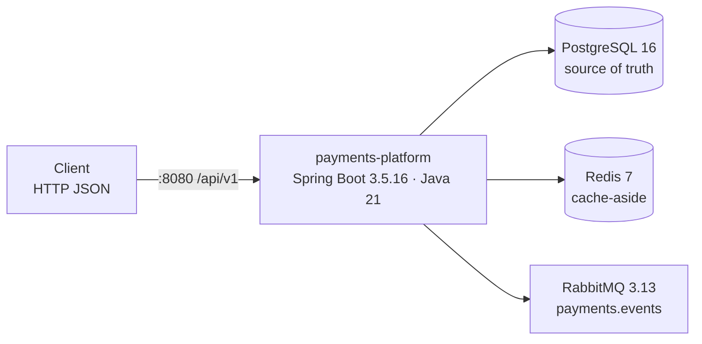
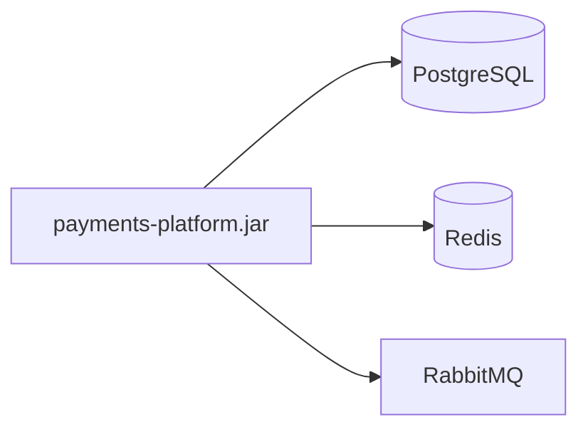
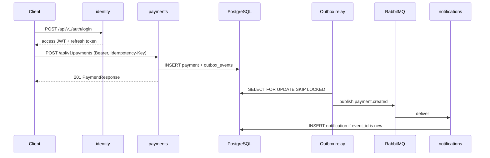
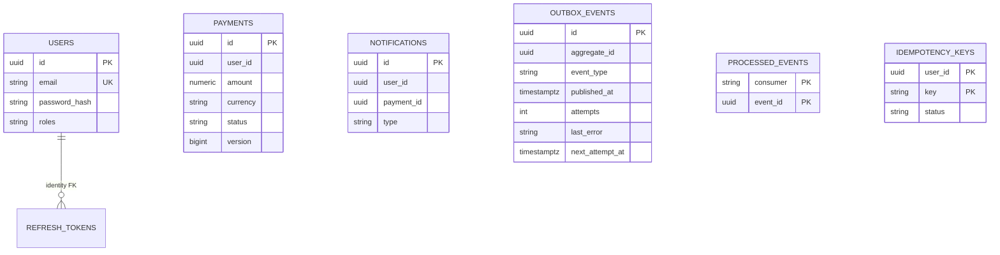

# Architecture — Payments Platform

One Spring Boot process (`com.muse.payments.PaymentsApplication`) on Java 21.
Modules: `identity`, `payments`, `notifications`, and an open `shared` kernel. Open means a Spring Modulith module of type `OPEN`: the other modules may depend on it. It holds ports and cross-cutting types, not payment rules.
The trip-planner slices in ADR 0001 are retired. See [ADR 0002](adr/0002-payments-pivot.md) and [ADR 0003](adr/0003-modular-monolith-vs-microservices.md).

## System context (C4 L1)

## Containers (C4 L2)

The application is one deployable. Redis, PostgreSQL, and RabbitMQ are separate processes.

## Components (C4 L3)

## Module map

| Module | Package | Owns | Talks to others |
|---|---|---|---|
| identity | `com.muse.payments.identity` | `users`, `refresh_tokens` | Issues JWT used by the other HTTP APIs. No foreign keys into payments. |
| payments | `com.muse.payments.payments` | `payments` | Appends integration events to `outbox_events`. Does not call the notifications repository. |
| notifications | `com.muse.payments.notifications` | `notifications` | Learns about payments only from RabbitMQ. |
| shared | `com.muse.payments.shared` | `outbox_events`, `processed_events`, `idempotency_keys` | Depended on by identity, payments, and notifications. Not a business module. |

`identity` and `payments` use `domain`, `application`, `infrastructure`, and `web`.
`notifications` has `domain`, `infrastructure`, and `web`, and no `application` package.
`NotificationController` calls `NotificationRepository` and returns the domain type `Notification`.
`domain` is plain Java: `ArchitectureTest` allows only the JDK and other `domain` packages.
Payment and identity commands, and the payment queries, go through application handlers. Identity has no query types.
Infrastructure holds JPA, Redis, and RabbitMQ adapters.

There is no cross-module foreign key. `payments.user_id` and `notifications.user_id` are UUID columns plus indexes. `refresh_tokens.user_id` references `users` because both tables belong to identity.

## Request paths

`GET /api/v1/payments/{id}` is cache-aside in Redis. PostgreSQL is read on a miss.
Confirm and cancel evict the key after the database transaction commits.

## HTTP contract

Base path `/api/v1`. Errors are RFC 7807 `application/problem+json` and omit the stack trace. `CorrelationIdFilter` accepts `X-Correlation-Id` when it is 1–64 characters from `[A-Za-z0-9_-]`, otherwise generates a UUID, echoes that value on the response header, and copies it onto the problem body as `correlationId`.

| Method | Path | Auth | Success |
|---|---|---|---|
| POST | `/api/v1/auth/register` | public | 201 |
| POST | `/api/v1/auth/login` | public | 200 |
| POST | `/api/v1/auth/refresh` | public | 200, rotated pair |
| POST | `/api/v1/auth/logout` | public | 204 |
| POST | `/api/v1/payments` | Bearer | 201, requires `Idempotency-Key` |
| GET | `/api/v1/payments/{id}` | Bearer, owner | 200 |
| GET | `/api/v1/payments` | Bearer | 200, page of the caller's payments |
| POST | `/api/v1/payments/{id}/confirm` | Bearer, owner | 200 |
| POST | `/api/v1/payments/{id}/cancel` | Bearer, owner | 200 |
| GET | `/api/v1/notifications` | Bearer | 200, caller's notifications |

Status codes the handlers return:

| Status | When |
|---|---|
| 400 | Bean validation, malformed JSON, missing `Idempotency-Key`, or a key longer than 120 characters |
| 401 | Missing or invalid bearer token, bad login or refresh credentials, or a disabled account (`BadCredentialsException` / `AuthenticationException`) |
| 404 | Unknown payment id, or a payment owned by someone else |
| 409 | Illegal payment transition, duplicate registration email, idempotency payload mismatch, idempotency key still in `PROCESSING`, optimistic lock, or `DataIntegrityViolationException` |
| 429 | Register, login, and refresh over 20 requests per minute for the client IP. `Retry-After` is `60`. Logout has no limit. |
| 500 | Unhandled exception, generic problem detail, no stack trace |

`403` is the body produced for `AccessDeniedException`. No controller or method-security rule checks a role, so an ownership failure stays `404`. Role names travel on the access token as the `roles` claim.

A repeated create with the same user, `Idempotency-Key`, and body returns the stored response and sets `Idempotent-Replayed: true`. `expires_at` is set 24 hours ahead. Lookups match `user_id` and `key` only, and nothing deletes expired rows, so a completed key still replays after that timestamp. Cancel takes an optional `reason` query parameter; the default is `Customer requested cancellation`. List payments takes `page` (default 0) and `size` (default 20; a size below 1 is treated as 20, and a size above 100 is treated as 100).

OpenAPI: `/v3/api-docs`. Swagger UI: `/swagger-ui.html`.

## Consistency and delivery

Create, confirm, and cancel commit the aggregate and the outbox row in one transaction.
`OutboxJpaAdapter.append` is `@Transactional(propagation = MANDATORY)`. `OutboxPort` itself is a plain interface.
The relay (`OutboxRelayService`) is scheduled when `app.outbox.scheduling.enabled` is unset or `true`. It polls every `app.outbox.poll-interval-ms` milliseconds (default 1000) and locks up to 50 due rows (`published_at IS NULL` and `next_attempt_at <= now`) with `FOR UPDATE SKIP LOCKED`.
It publishes to the topic exchange `payments.events` and sets `published_at` when `convertAndSend` returns. It does not wait on the correlated publisher confirm, so a later nack or unroutable return leaves `published_at` set.

| Outbox `event_type` | Routing key | Queue |
|---|---|---|
| `PaymentCreated` | `payment.created` | `payments.created.notifications` |
| `PaymentCompleted` | `payment.completed` | none |
| `PaymentCancelled` | `payment.cancelled` | none |

Confirm and cancel therefore publish an event that no queue binds. They do not create a notification.
`PaymentNotificationConsumer` listens only on `payments.created.notifications`. It inserts the notification and a `processed_events` row (`consumer = PaymentNotificationConsumer`, primary key `(consumer, event_id)`) in one transaction. A second delivery of the same event id does not insert a second notification.
That is at-least-once delivery plus an idempotent consumer for `payment.created`.

When `convertAndSend` throws, the relay increments `attempts`, stores `last_error`, and sets `next_attempt_at` to `min(300, 2^attempts * 2 + jitter)` seconds. Jitter is an integer from 1 through 3. The delay caps at 300 seconds and the row stays eligible, so a publish that keeps failing is retried indefinitely at that cap.

`payments.created.notifications` is a durable queue with dead-letter exchange `payments.events.dlx` (direct) and dead-letter routing key `payment.created.dlq`, bound to the durable queue `payments.created.notifications.dlq`.
`RabbitMqConfig` does not change `defaultRequeueRejected`. Processing failures in `PaymentNotificationConsumer` are rethrown as `RuntimeException`, and Spring's default error handler requeues that onto `payments.created.notifications`. The queue has no message TTL or max length. Spring rejects without requeue for message-conversion and argument-resolution failures; this listener takes a `String` payload and optional headers, and it turns JSON problems into `RuntimeException`, so those messages are requeued rather than dead-lettered. A payload that parses but is missing `paymentId`, `userId`, `amount`, or `currency` is acknowledged and dropped after `processed_events` records the event id.
`spring.rabbitmq.publisher-confirm-type` is `correlated`, `publisher-returns` is true, and the `RabbitTemplate` is mandatory.

## Boundaries

`ModularityTest` calls `ApplicationModules.of(PaymentsApplication.class).verify()`.
`ArchitectureTest` rejects `@Autowired` fields and any `domain` dependency outside the JDK and `domain` packages, which keeps Spring, JPA, Redis, and RabbitMQ out of the domain.
Production types take dependencies by constructor. The field-injection rule does not scan tests.

## Data model

Selected columns. The Flyway scripts are the full schema.

Flyway migrations are append-only: `V1` `outbox_events`, `processed_events`, and `idempotency_keys`; `V2` identity; `V3` payments; `V4` notifications.
