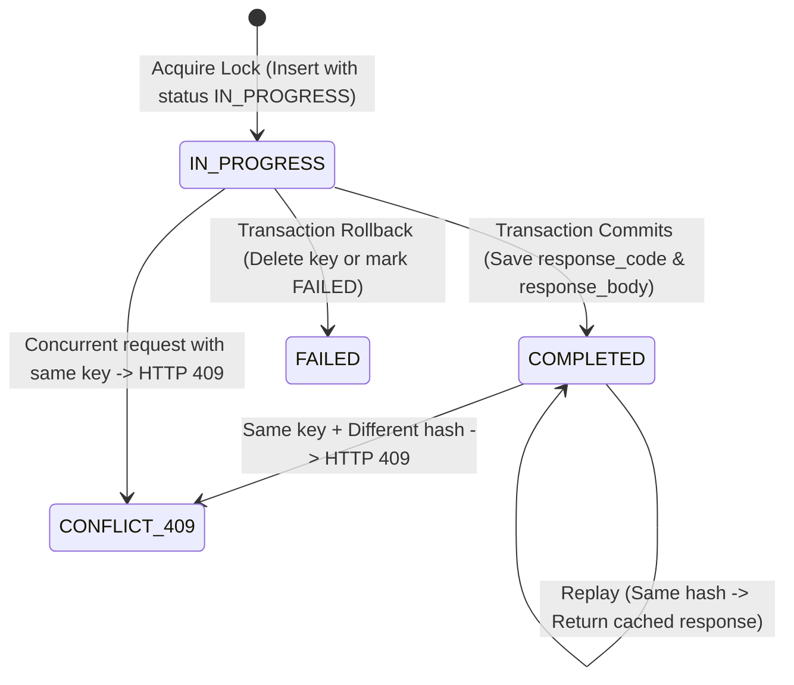
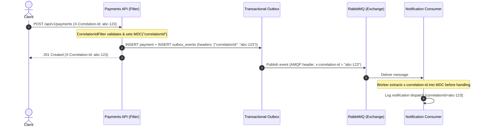

# Specification: Idempotency, Idempotency-Key, Correlation-ID & Immutability Patterns

**Standard**: RFC 7807, IETF draft-ietf-httpapi-idempotency-key-header, W3C Trace Context  
**Scope**: Cross-Cutting Architecture Specification for Payments Platform

---

## 1. Executive Summary

Financial payments platforms require absolute consistency, zero duplicate charges, full auditability, and distributed traceability. This specification defines four foundational architectural pillars:

1. **HTTP Idempotency-Key Pattern**: Protection against duplicate mutating requests caused by network retries, double-clicks, or timeouts.
2. **Correlation-ID & Traceability Pattern**: End-to-end distributed transaction tracking across HTTP boundaries, internal MDC logging, Transactional Outbox, RabbitMQ messages, and asynchronous consumers.
3. **Immutability Standards**: Strict immutability guarantees for domain events, value objects, outbox logs, and state transition histories.
4. **Idempotent Consumer (Inbox) Pattern**: Exactly-once processing side-effects from at-least-once messaging delivery via atomic event deduplication.

---

## 2. Idempotency-Key Protocol (IETF Standard)

### 2.1 HTTP Contract
- Mutating endpoints (`POST /api/v1/payments`, `POST /api/v1/payments/{id}/confirm`, `POST /api/v1/payments/{id}/cancel`) **require** the HTTP header:
  ```http
  Idempotency-Key: <opaque-string>
  ```
- **Key Constraints**:
  - Max length: 120 characters.
  - Allowed characters: alphanumeric, hyphens, underscores (`^[a-zA-Z0-9_-]{1,120}$`).
  - Missing key on mutating endpoints returns `HTTP 400 Bad Request` with `ProblemDetail` ("Idempotency-Key header is required").

### 2.2 Lifecycle & State Machine
An idempotency record progresses through atomic states:



### 2.3 Scope & Collision Protection
- **Compound Key**: `(user_id, key)` is the database Primary Key.
- Keys are partitioned per authenticated user; Client A and Client B generating identical UUIDs never collide or share cached responses.

### 2.4 Payload Hashing (Fingerprinting)
- The server computes a SHA-256 digest of `(HTTP Method + Request URI + Canonical Request Body)`:
  ```
  request_hash = SHA256(Method + "|" + URI + "|" + NormalizedBody)
  ```
- **Replay Behavior**:
  1. **Exact Replay** (`status == COMPLETED` and `saved_hash == current_hash`):
     - Return the exact cached HTTP response status and body (e.g. `201 Created` or `200 OK`).
     - Attach header `Idempotent-Replayed: true`.
  2. **Hash Mismatch** (`status == COMPLETED` and `saved_hash != current_hash`):
     - Reject with `HTTP 409 Conflict`.
     - Detail: `"Idempotency key was previously used with a different request payload."`
  3. **Concurrent Lock** (`status == IN_PROGRESS` and `now < expires_at`):
     - Reject with `HTTP 409 Conflict` (or `HTTP 429 Too Many Requests`).
     - Detail: `"A request with this idempotency key is currently being processed."`

---

## 3. Correlation-ID Pattern

### 3.1 Distributed Flow
Every request is tagged with an immutable correlation identifier that traverses synchronous and asynchronous boundaries:



### 3.2 Constraints
- Header name: `X-Correlation-Id`.
- Format: `^[a-zA-Z0-9_-]{1,64}$`.
- If client provides a valid header, use it; otherwise generate `UUID.randomUUID().toString()`.
- Always echo `X-Correlation-Id` in every HTTP response (both 2xx success and RFC 7807 error responses).
- Automatically bound to SLF4J MDC (`correlationId`) for structured ECS JSON log emission.

---

## 4. Immutability Standards

### 4.1 Value Objects
- Implemented as Java `record` types or final classes with final fields.
- Value equality (`equals()` and `hashCode()`) based exclusively on structural properties.
- No setters or mutating methods. Methods returning altered state must produce new instances (e.g. `Money.add()`).

### 4.2 Domain Events
- Implemented as immutable `record` components implementing `DomainEvent`.
- Every domain event possesses:
  - `UUID eventId`: Immutable identifier generated at creation.
  - `Instant occurredAt`: Timestamp of the domain transition.
  - Zero mutable fields or collection references (all collections wrapped via `List.copyOf` / `Set.copyOf`).

### 4.3 Outbox and Audit Trails
- `outbox_events` and `processed_events` are append-only.
- Updates are restricted to publishing metadata (`published_at`, `attempts`, `last_error`).
- Payloads and headers are stored as immutable `JSONB` snapshots; once committed, event data is immutable.

---

## 5. Idempotent Consumer (Inbox Pattern)

### 5.1 Motivation
RabbitMQ provides at-least-once delivery. Network partitions, consumer retries, and ack timeouts will cause duplicate message deliveries.

### 5.2 Atomic Deduplication
- Table: `processed_events (consumer VARCHAR(150), event_id UUID, processed_at TIMESTAMPTZ, PRIMARY KEY(consumer, event_id))`.
- Within the consumer's transactional boundary:
  1. Insert into `processed_events (consumer, event_id)`.
  2. If duplicate key violation occurs (`DataIntegrityViolationException`), the event was already processed.
  3. Acknowledge message immediately and skip side-effect execution.
  4. If insert succeeds, execute consumer action and commit transaction.
