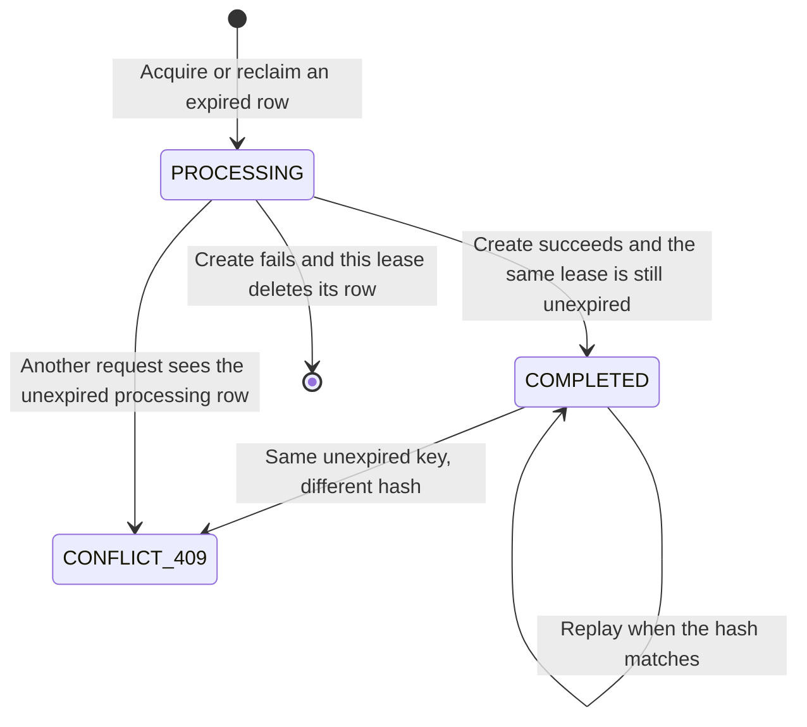
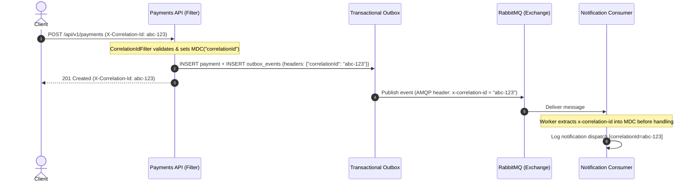

# Specification: Idempotency, Idempotency-Key, Correlation-ID & Immutability Patterns

**Standard**: RFC 7807, IETF draft-ietf-httpapi-idempotency-key-header, W3C Trace Context  
**Scope**: Cross-Cutting Architecture Specification for Payments Platform

---

## 1. Executive Summary

Financial payments platforms require absolute consistency, zero duplicate charges, full auditability, and distributed traceability. This specification defines four foundational architectural pillars:

1. **HTTP Idempotency-Key Pattern**: Protection against duplicate mutating requests caused by network retries, double-clicks, or timeouts.
2. **Correlation-ID & Traceability Pattern**: End-to-end distributed transaction tracking across HTTP boundaries, internal MDC logging, Transactional Outbox, RabbitMQ messages, and asynchronous consumers.
3. **Immutability Standards**: Strict immutability guarantees for domain events, value objects, outbox logs, and state transition histories.
4. **Idempotent Consumer (Inbox) Pattern**: Exactly-once processing side-effects from at-least-once messaging delivery via atomic event deduplication.

---

## 2. Idempotency-Key Protocol (IETF Standard)

### 2.1 HTTP Contract
- `POST /api/v1/payments` requires the header:
  ```http
  Idempotency-Key: <opaque-string>
  ```
- Confirm and cancel do not take this header. They are owner-scoped state transitions guarded by optimistic locking.
- **Key constraints**:
  - Trimmed value must be non-blank and at most 120 characters (the `idempotency_keys.key` column).
  - A missing or blank key returns `HTTP 400` with title `Validation Error` and detail `Idempotency-Key header is required for payment creation`.
  - A key longer than 120 characters returns `HTTP 400` with detail `Idempotency-Key header must not exceed 120 characters`.

### 2.2 Lifecycle & State Machine
Stored statuses are `PROCESSING` and `COMPLETED`. Each acquisition has its own `lease_id`.



- A failed create deletes only the `PROCESSING` row for that `lease_id` and request hash, so the client can retry the same key.
- Completion updates a row only when it is still `PROCESSING`, the request hash matches, `lease_id` matches, and `expires_at` is in the future. A late completion cannot overwrite a newer acquisition.
- There is no `FAILED` status.

### 2.3 Scope & Collision Protection
- **Compound Key**: `(user_id, key)` is the database Primary Key.
- Keys are partitioned per authenticated user; Client A and Client B generating identical UUIDs never collide or share cached responses.

### 2.4 Payload Hashing (Fingerprinting)
- The server stores the lowercase SHA-256 hex of the canonical JSON body. Amount is scaled to 2 decimal places and currency is uppercased before `ObjectMapper` serialization, so `10` and `10.00`, or `brl` and `BRL`, are the same request:
  ```
  request_hash = SHA256(canonicalJsonBody)
  ```
- **Replay behavior**:
  1. **Exact replay** (`status == COMPLETED`, unexpired, hashes equal ignoring case):
     - Return the cached status and body.
     - Header `Idempotent-Replayed: true`.
  2. **Hash mismatch** (`status == COMPLETED`, unexpired, hashes differ):
     - `HTTP 409`. Detail: `Idempotency key payload mismatch for key: <key>`.
  3. **In flight** (`status == PROCESSING` and unexpired):
     - `HTTP 409`. Detail: `Concurrent request in progress for idempotency key: <key>`.
  4. **Any other unexpired status**:
     - `HTTP 409`. Detail: `Idempotency key cannot be reused while it is unexpired: <key>`.
     - The request does not create another payment.
  5. **Expired key** (`expires_at <= now`, any status):
     - Treat the key as new. The insert reclaims the existing row only when it is already expired (`ON CONFLICT ... WHERE idempotency_keys.expires_at <= EXCLUDED.created_at`), and it replaces `lease_id`. A live row and a concurrent reclaim cannot both proceed.
     - Each cleanup run deletes expired rows in batches of 500 with `FOR UPDATE SKIP LOCKED` until a short batch remains, and repeats the expiry predicate on the delete. The interval is `app.idempotency.cleanup-interval-ms` (default 1 hour). Lookup uses `idx_idempotency_expires`.

---

## 3. Correlation-ID Pattern

### 3.1 Distributed Flow
Every request is tagged with an immutable correlation identifier that traverses synchronous and asynchronous boundaries:



### 3.2 Constraints
- Header name: `X-Correlation-Id`.
- Format: `^[a-zA-Z0-9_-]{1,64}$`.
- If client provides a valid header, use it; otherwise generate `UUID.randomUUID().toString()`.
- Always echo `X-Correlation-Id` in every HTTP response (both 2xx success and RFC 7807 error responses).
- Automatically bound to SLF4J MDC (`correlationId`) for structured ECS JSON log emission.

---

## 4. Immutability Standards

### 4.1 Value Objects
- Implemented as Java `record` types or final classes with final fields.
- Value equality (`equals()` and `hashCode()`) based exclusively on structural properties.
- No setters or mutating methods. Methods returning altered state must produce new instances (e.g. `Money.add()`).

### 4.2 Domain Events
- Implemented as immutable `record` components implementing `DomainEvent`.
- Every domain event possesses:
  - `UUID eventId`: Immutable identifier generated at creation.
  - `Instant occurredAt`: Timestamp of the domain transition.
  - Zero mutable fields or collection references (all collections wrapped via `List.copyOf` / `Set.copyOf`).

### 4.3 Outbox and Audit Trails
- `outbox_events` and `processed_events` are append-only.
- Updates are restricted to publishing metadata (`published_at`, `attempts`, `last_error`).
- Payloads and headers are stored as immutable `JSONB` snapshots; once committed, event data is immutable.

---

## 5. Idempotent Consumer (Inbox Pattern)

### 5.1 Motivation
RabbitMQ provides at-least-once delivery. Network partitions, consumer retries, and ack timeouts will cause duplicate message deliveries.

### 5.2 Atomic Deduplication
- Table: `processed_events (consumer VARCHAR(150), event_id UUID, processed_at TIMESTAMPTZ, PRIMARY KEY(consumer, event_id))`.
- Within the consumer's transactional boundary:
  1. Insert into `processed_events (consumer, event_id)`.
  2. If duplicate key violation occurs (`DataIntegrityViolationException`), the event was already processed.
  3. Acknowledge message immediately and skip side-effect execution.
  4. If insert succeeds, execute consumer action and commit transaction.
