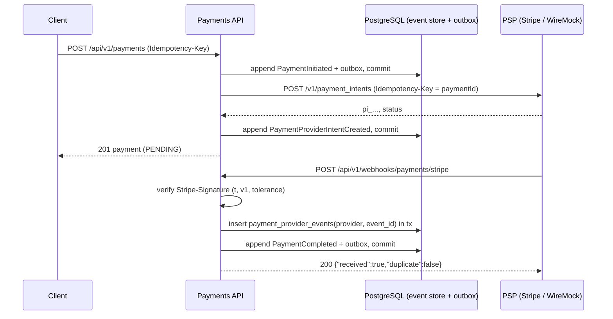

# Spec 014 — Multi-provider PSP integration and signed payment webhooks

- **Status**: Implemented
- **Updated**: 2026-11-18
- **Related**: [ADR 0019](../../docs/adr/0019-psp-provider-strategy-and-webhooks.md), [Spec 003](../003-payments/spec.md)

## Goal

Connect the payments core to an external Payment Service Provider (PSP) through a
provider-neutral strategy port, and receive signed asynchronous callbacks on
`POST /api/v1/webhooks/payments/{provider}`. Stripe is the reference adapter; Adyen,
MercadoPago, or any other PSP must be addable by shipping one adapter bean and its
configuration, without touching the aggregate, the use cases, the controller, or the
database schema.

The local PSP is a WireMock stub. No real money moves and no real Stripe credential is
required or stored.

## Scope & acceptance criteria

1. **Provider port in the payments domain**: `PaymentProviderStrategy` with
   `providerId()`, `createIntent(ProviderIntentRequest)`, and
   `verifyAndParse(ProviderWebhookRequest)`. Domain stays free of Spring, Jackson,
   HTTP clients, and Resilience4j.
2. **Stripe reference adapter** in `payments/infrastructure/psp/stripe`:
   - creates a PaymentIntent through `POST {base-url}/v1/payment_intents` with form
     encoding, bearer API key, and `Idempotency-Key = paymentId`;
   - verifies `Stripe-Signature` exactly as documented by Stripe: HMAC-SHA256 over
     `"{t}.{rawBody}"`, constant-time comparison against every `v1` entry, a mandatory
     `t`, and a configurable timestamp tolerance (default 5 minutes);
   - maps `payment_intent.succeeded` to `SUCCEEDED`, `payment_intent.payment_failed`
     and `payment_intent.canceled` to `FAILED`, and everything else to `UNKNOWN`.
3. **Provider resolution**: `{provider}` in the webhook path is matched
   case-insensitively against the registered strategy beans. An unregistered provider
   is `404 application/problem+json`; it never falls back to the default provider.
4. **Full payment flow**: `CreatePayment` persists the payment first, then a
   post-commit use case asks the provider for an intent and appends
   `PaymentProviderIntentCreated`. A signed `payment_intent.succeeded` webhook
   completes the payment and appends `PaymentCompleted` plus its outbox row. A failed
   or canceled intent cancels the payment under the review/cancel rules already in the
   aggregate.
5. **Replay and duplicate protection**:
   - the signature timestamp must be inside the tolerance window, so a captured
     payload cannot be replayed later;
   - `(provider, event_id)` is a primary key in `payment_provider_events`; the row is
     inserted in the same transaction as the settlement, so a failed settlement rolls
     the dedupe row back and the provider retry is processed;
   - a duplicate delivery returns `200` with `duplicate: true` and changes nothing.
6. **Event store integrity**: provider settlement is a normal aggregate command. It
   emits the existing `PaymentCompletedEvent` / `PaymentCancelledEvent`, keeps the
   outbox `Propagation.MANDATORY` contract, and writes no read model directly.
7. **Security**: `/api/v1/webhooks/**` is `permitAll` because the HMAC signature is the
   authentication; it is excluded from CSRF (already stateless) and from the payment
   write rate limiter, which is keyed by user id and webhooks have no user. Signature
   failures are `400` and are logged without the body, the secret, or the signature.
8. **Tests**: signature unit tests (valid, tampered, wrong secret, stale timestamp,
   `v0` only, multiple `v1`), Stripe adapter unit tests against WireMock (intent
   creation, form fields, idempotency header, event parsing), domain settlement tests,
   and a Testcontainers integration test covering the happy path, duplicate delivery,
   unknown provider, bad signature, unknown event type, and reference mismatch.

## Design

### Layers

```
web        PaymentWebhookController            (raw body, provider path, ack)
application PaymentProviderRegistry            (provider id -> strategy)
           InitiateProviderPaymentUseCase      (post-commit intent creation)
           ProcessProviderWebhookUseCase       (dedupe + settle, one transaction)
           PaymentProviderEventStorePort       (dedupe persistence port)
domain     PaymentProviderStrategy (port)
           ProviderIntentRequest / ProviderIntent
           ProviderWebhookRequest / ProviderWebhookEvent / ProviderEventOutcome
           InvalidProviderSignatureException
infra      StripePaymentProviderAdapter
           StripeProviderProperties / StripeProviderConfiguration
           JdbcPaymentProviderEventStore
```

The port lives in `payments/domain/psp` because it is a business contract: "a payment
can be sent to a provider and the provider can call back". Records carry only JDK and
domain types. The adapters own HTTP, JSON, signing, and configuration.

### Flow



Intent creation is deliberately **outside** the create transaction: an external HTTP
call must not hold a database connection (same rule as fraud screening, ADR 0012 and
0015). When the provider call fails, the payment stays `PENDING` without a provider
reference, an error is logged with the payment id, and a counter
`payments.psp.intent.failed` is incremented. Reconciliation is out of scope for this
sample; the failure is never silent.

### Aggregate changes

`Payment` gains `provider` and `providerReference`, set by
`PaymentProviderIntentCreatedEvent`, and one command:

```
settleFromProvider(provider, providerReference, succeeded, reason, occurredAt)
```

- rejects a provider or reference that does not match the recorded intent
  (`ConflictException`), so a valid signature for provider A cannot settle a payment
  routed to provider B;
- `succeeded` on a `PENDING` payment raises `PaymentCompletedEvent`;
- a repeated `succeeded` on an already `COMPLETED` payment is a no-op for that
  aggregate instance (the event-id dedupe already filtered the normal case);
- failure raises `PaymentCancelledEvent` with a bounded reason; it follows the same
  status guard as `cancel()`, so a `COMPLETED` payment is not cancelled retroactively;
- an `UNDER_REVIEW` payment is not settled: it was held for fraud review and only a
  reviewer can release it. The webhook is acknowledged and counted as ignored.

`PaymentProviderIntentCreatedEvent` is registered in `PaymentEventRegistryConfiguration`
(type `payments.payment-provider-intent-created`, version 1) so replay and projections
work unchanged. `PaymentProjector` writes `provider` and `provider_reference` to the
`payments` read model.

### Data model (`V9__payment_provider_webhooks.sql`)

```sql
ALTER TABLE payments ADD COLUMN provider VARCHAR(30);
ALTER TABLE payments ADD COLUMN provider_reference VARCHAR(120);
CREATE UNIQUE INDEX uq_payments_provider_reference
    ON payments (provider, provider_reference)
    WHERE provider_reference IS NOT NULL;

CREATE TABLE payment_provider_events (
    provider    VARCHAR(30)  NOT NULL,
    event_id    VARCHAR(120) NOT NULL,
    event_type  VARCHAR(120) NOT NULL,
    payment_id  UUID,
    outcome     VARCHAR(30)  NOT NULL,
    received_at TIMESTAMPTZ  NOT NULL DEFAULT NOW(),
    PRIMARY KEY (provider, event_id)
);
CREATE INDEX idx_payment_provider_events_received_at
    ON payment_provider_events (received_at);
```

No foreign key to `payments`: `payments` is a rebuildable projection and a projection
rebuild truncates it. The dedupe table is module-local state, consistent with the
"no cross-module FK" rule and with the projection rebuild invariant.

### HTTP contract

`POST /api/v1/webhooks/payments/{provider}`

- `Content-Type: application/json`; the body is read as raw bytes and is never
  re-serialized before signature verification.
- Provider header: Stripe uses `Stripe-Signature`.
- `200` `{"provider":"stripe","eventId":"evt_...","outcome":"COMPLETED|CANCELLED|IGNORED|DUPLICATE"}`
- `400` invalid/missing signature, malformed header, timestamp outside tolerance, or a
  body that is not valid JSON → RFC 7807.
- `404` provider not registered → RFC 7807.
- `500` only for unexpected local failures, so the provider retries. A business
  mismatch (payment missing, reference mismatch, held payment) is `200` with
  `IGNORED` and a metric, because retrying will not change the outcome.

The endpoint is documented in OpenAPI but not reachable through JWT: the signature is
the credential.

### Configuration

```yaml
app:
  psp:
    stripe:
      enabled: ${STRIPE_ENABLED:true}
      base-url: ${STRIPE_BASE_URL:http://localhost:12111}
      api-key: ${STRIPE_API_KEY:sk_test_local}
      webhook-secret: ${STRIPE_WEBHOOK_SECRET:whsec_local_dev_only}
      webhook-tolerance: ${STRIPE_WEBHOOK_TOLERANCE:5m}
      connect-timeout: 300ms
      read-timeout: 3s
```

Startup fails when `prod` is active and the secret is blank or the well-known local
default, mirroring the HTTPS check on fraud screening. The secret is never logged.

### Extending to another provider

1. Implement `PaymentProviderStrategy` in `infrastructure/psp/<provider>`.
2. Register it as a bean; `PaymentProviderRegistry` builds the id map from the injected
   list.
3. Add configuration and, if the callback shape differs, the adapter's parser.
4. No change to `Payment`, use cases, controller, schema, or existing adapters.
5. Register the webhook URL `https://host/api/v1/webhooks/payments/<provider>` with the
   PSP and store its signing secret.

## Failure policy

| Situation | Result | Why |
|---|---|---|
| Bad or missing signature | 400, no processing | unauthenticated caller |
| Timestamp outside tolerance | 400, no processing | replay window |
| Duplicate `(provider, event_id)` | 200 duplicate | provider retry after a lost ack |
| Unknown event type | 200 ignored | not subscribed / forward compatibility |
| Unknown provider | 404 | configuration error, never a default fallback |
| Payment not found | 200 ignored + metric | retrying cannot fix a bad reference |
| Provider/reference mismatch | 200 ignored + metric | cannot settle a different payment |
| Payment `UNDER_REVIEW` | 200 ignored + metric | fraud hold requires a reviewer |
| Settlement write fails | rollback + 500 | provider retries; dedupe row also rolled back |

## Testing

- `StripeWebhookSignatureTest` — pure unit, fixed clock, covers the header grammar and
  the tolerance.
- `StripePaymentProviderAdapterTest` — WireMock server, asserts the form body, the
  bearer header, the idempotency key, zero-decimal currency conversion, and event
  mapping.
- `PaymentProviderSettlementTest` — aggregate rules: happy path, mismatch, held
  payment, already completed, cancelled.
- `PspWebhookIT` — Testcontainers + MockMvc + WireMock: create → intent stored →
  signed webhook → `COMPLETED`; duplicate, bad signature, stale timestamp, unknown
  provider, unknown event type, reference mismatch.

## Out of scope

- Real PSP credentials, live money, and production onboarding.
- Refunds, disputes, partial captures, and multi-currency settlement.
- A reconciliation sweeper for payments whose intent creation failed.
- Webhook payload retention beyond the dedupe row and its index.

## Eval

```bash
rtk proxy mvn -B -Dtest=StripeWebhookSignatureTest,StripePaymentProviderAdapterTest,PaymentProviderSettlementTest test
rtk proxy mvn -B -Dit.test=PspWebhookIT verify
rtk proxy bash scripts/ci-local.sh
```

Expected result: the focused tests pass, the webhook integration test processes a
signed `payment_intent.succeeded` into `COMPLETED` exactly once, and the strict local
gate reports `ALL LOCAL CI CHECKS PASSED`.
